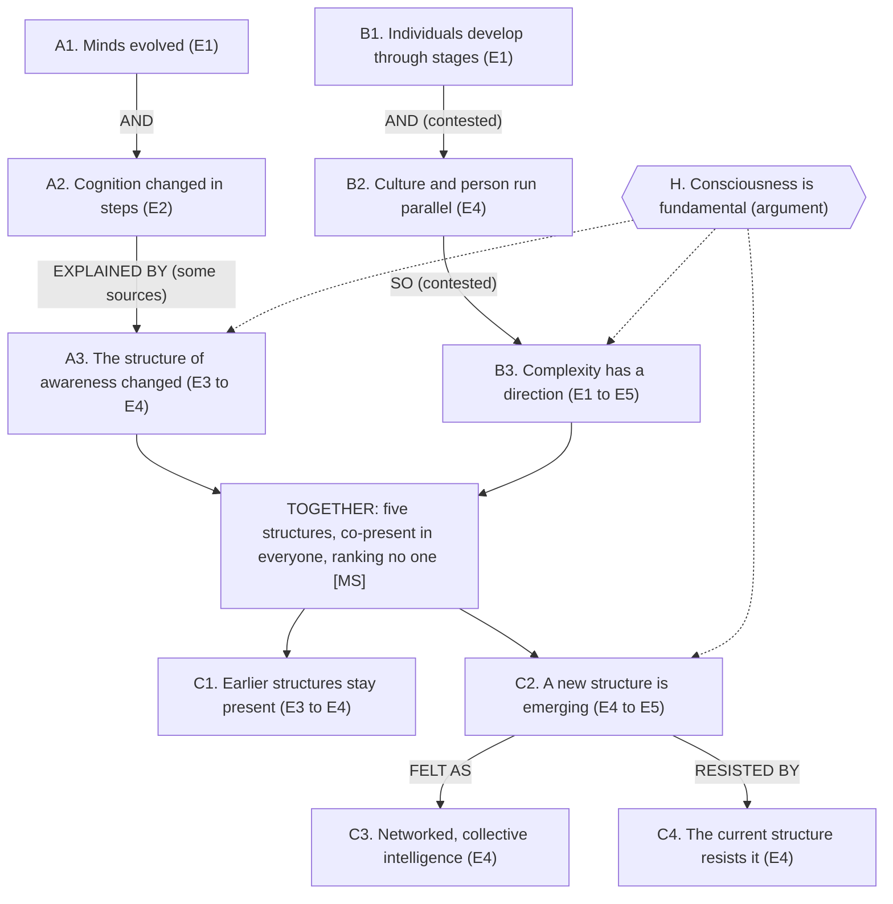

The sources agree that minds evolved, that human cognition changed in dated steps and that earlier modes of mind stay present; they split on whether those steps changed the structure of awareness and on whether complexity has a direction, and the claim that a new, networked structure is emerging now rests on theory and testimony.

## Overview

Has human awareness itself changed over history, and what would show it? This page tests one answer to that question one step at a time. The wiki's [[concepts/major-evolutionary-transitions|Major Evolutionary Transitions]] reads human history as five [[concepts/structures-of-consciousness|structures of consciousness]]: Mimetic, Magical, Mythic, Material and Mycelial. A structure of consciousness is a shared way of experiencing self, time and world; the term is Jean Gebser's. The five names and the synthesis across them are Michael Haupt's, built on Roger Briggs's *Emerging World* (2021) [MS].

The argument behind that sequence breaks into a chain of eleven claims. For each claim, this page asks two questions: what do the sources say about it, and what kind of evidence does it rest on? Forty-seven sources take part, from neuroscience and archaeology to contemplative and Indigenous traditions. Critics are in by design.

The result is uneven. The early steps rest on measured studies and dated finds [IC]. The middle steps rest on theories built from those finds, and the theories disagree. The later steps, about a new structure emerging now, rest on theory and first-person testimony; no measured study in the grid shows the change at population level [IC]. The network's own pages give dates that differ from each other by orders of magnitude, and some of them differ from the dated record.

The grid lives in three sortable tables below. Each source keeps its position on its own page in the [[sources/index|sources]] register; each step of the chain has a page of its own; each dated threshold has a short entry. The companion [[research/evolution-of-consciousness/library|library]] holds the full set of 101 works the grid draws from.

> [!note] How this page describes others
> This page describes authors, the South African San Council, the South African San Institute, the Rock Art Research Institute and other bodies only through what they have published. None has yet been invited to comment. Responses and corrections will be recorded here with their date. On this page `[MS]` marks a claim that comes from Michael Haupt's own project documents.

## The grid's form

The grid lays out a chain of claims, each labelled with the kind of evidence behind it and joined to the next by a connecting word, above a matrix of sources and their positions. 

**Disclosure.** The grid includes critics by design: eight sources sit in the critics' row, and others dissent on single steps. The wording of the chain is the network's. The TOGETHER step is Michael Haupt's position [MS].

## The distinctions

A change in culture counts as evidence of a change in consciousness only where a source argues the link. A change in what people believe is a change of content; a change in how awareness is organised is a change of structure, which is Gebser's claim. Personal development and cultural history may or may not follow the same order (step B2), and the grid treats that as a claim of its own.

A sequence in time puts structures in order. It puts no living person or people in that order, and this page places none. Where a source does place peoples or nations on a scale, the page reports that the source does so and repeats none of the placements.

The metaphysical question (is consciousness fundamental?) stays apart from the historical one (have its human forms changed?). Gebser, Graves, Kegan, Donald, Briggs and Sahtouris keep their own lineages and terms. "Mycelial" is the network's metaphor for a form of coordination; fungal network science is evidence about fungi.

Each step carries one of five evidence types, the codes the library uses:

| Code | Type | What it means |
|---|---|---|
| E1 | Measured study | Experiment, comparative study or validated instrument, with replication |
| E2 | Dated record | Fossil, archaeological or documentary record with published dating |
| E3 | Theory on evidence | A theory built on reviewed evidence and tested against it |
| E4 | Synthesis or speculation | A framework, synthesis or model with illustrative cases |
| E5 | Tradition or testimony | Contemplative, religious or Indigenous tradition; first-person report |

E5 is a separate kind of knowledge and should not be ranked lower than the others. The grid records which kind each claim rests on, so readers can see it.

## The claim chain

The chain below is the one the research run tested, with its wording refined where the sources showed a step was stated badly. Each step links to its own page, which lists the sources on each side.

The dotted lines mark the three steps that read differently depending on the answer to H.

![[evolution-of-consciousness-chain.base]]

The table lists each step with its connecting word, its evidence type, whether it depends on H and the count of grid sources on each side.

## The grid

![[evolution-of-consciousness-grid.base]]

The first tab is the matrix: sources down the side in nine row groups, steps across the top. ● marks a source that affirms the step, ◐ one that qualifies it and ✕ one that dissents; a blank square means the source is silent on that step. The second tab gives the same matrix in words. One tab per step then lists every source with a position on it, with a sentence on what the source says, where it says it and the grade of that reading. The last two tabs show the critics and Michael Haupt's reading.

Most position codes rest on the works' known arguments and published summaries; the chapter references in the grid need checking against the books, and 85 of the 137 coded squares carry `[TBV]` for that reason.

## Step by step

### A1. Minds evolved

Feinberg and Mallatt place sensory consciousness in the Cambrian across vertebrates, arthropods and cephalopods [TBV]. Ginsburg and Jablonka use unlimited associative learning as the marker of minimal consciousness [TBV]. The New York Declaration on Animal Consciousness, launched at New York University on 19 April 2024, finds "strong scientific support" for consciousness in mammals and birds, and a realistic possibility in all vertebrates and many invertebrates [IC]. Accounts of its first signatories differ (39 in some, 40 on the declaration's own page), and later counts run into the hundreds [TBV]. Dennett and Seth, working from physicalism, agree that consciousness comes in degrees. Michael Levin's framework, TAME, treats cognition as continuous from cells and tissues to whole organisms, with the shaping of a body (morphogenesis) as a basal form of cognition [IC]. Donald Hoffman accepts that selection shaped perception, and denies that the evolved interface shows reality as it is [TBV]. No grid source dissents from A1; the disagreement is over how far down the tree of life awareness goes.

### A2. Human cognition changed in identifiable steps

Merlin Donald describes three transitions: mimetic skill with *Homo erectus*, mythic culture with speech, and theoretic culture with external symbols such as writing [IC]. Robert Bellah builds a history of religion on Donald's stages [IC]. Walter Ong separates oral cultures from literate ones [IC]. Michael Tomasello explains cumulative culture through a ratchet effect, in which each generation keeps what the last one learned [IC]. The dated record (see the dating table) gives this step its strength. The live disputes concern single sites: Martinón-Torres and colleagues reject the claim that *Homo naledi* buried its dead [IC]. Twelve sources affirm the step and one dissents.

### A3. The steps changed the structure of awareness

Here the sources split. Gebser holds that mutations changed how awareness is organised in space and time [IC]. Julian Jaynes argues that introspective consciousness replaced a [[glossary/a-e/bicameral-mind|bicameral mind]] in which commands were heard as the voices of gods [IC]. Owen Barfield traces a move from original participation to the onlooker consciousness of modern science [TBV]. Iain McGilchrist ties shifts in Western culture to the balance between the brain's hemispheres [IC]. Ong argues that writing restructures thought [IC].

Donald, Steven Mithen, Terrence Deacon and Robert Bellah describe the same steps as changes in cognitive capacity and memory, and stop short of claims about the structure of awareness [TBV]. Ned Block's review of Jaynes argues that Jaynes mistook a change in the concept of consciousness for a change in consciousness [TBV]. Nine sources affirm A3, six qualify it and one dissents. It is a theory step: no measured study tests it.

### B1. Individuals develop through stages

Jane Loevinger's ego stages are measured with the Washington University Sentence Completion Test (WUSCT). A meta-analysis by Cohn and Westenberg (2004) pooled 65 studies with more than 9,000 participants: ego level correlates with intelligence at about r = .30 and still adds predictive value of its own [IC]. A 2026 systematic review in *Assessment* covered 51 studies and found support for the test's reliability and validity, with results that vary by sample and setting [IC]. The case for Robert Kegan's Subject-Object Interview rests mostly on its own training manual and on practitioner work [TBV]. Spiral Dynamics has no psychometrically validated instrument, and Clare Graves's own data were never published in peer-reviewed form [IC]. Carl Jung describes individuation as a lifelong process of becoming whole, without measured stages [TBV].

The [[concepts/structures-of-consciousness|Structures of Consciousness]] page calls the convergence of Gebser, Graves, Kegan and Cook-Greuter "one of the central evidentiary pillars of the corpus" [MS]. Graded through B1 and B2, the pillar holds for individual stages measured with Loevinger's instrument, the line Cook-Greuter extends, and is weak where it reaches for parallels with cultural history.

### B2. Culture and person follow parallel sequences

Don Beck and Christopher Cowan apply the same colour-coded levels to persons, organisations and societies [IC]. Ken Wilber holds individual and cultural development broadly parallel, with stated limits [TBV]. Steve McIntosh treats worldviews as stages of cultural evolution [TBV]. David Graeber and David Wengrow reject evolutionary stages of society [IC]. Mithen uses child development only as a cautious analogy and warns against reading it as recapitulation, the old idea that each person replays the history of the species [TBV]. No measured study in the grid shows a cultural sequence matching an individual one.

### B3. Complexity has a direction

Eric Chaisson measures energy rate density, the energy flowing through a system per unit of mass, rising from galaxies and stars to plants, animals and societies [TBV]. John Maynard Smith and Eörs Szathmáry describe major transitions in how information is stored and passed on, with no necessary direction [IC]. Ilya Prigogine argues that irreversible processes far from equilibrium create order and give nature an arrow of time, and makes no claim about consciousness [TBV]. Pierre Teilhard de Chardin, Sri Aurobindo and Wilber read a spiritual direction into the rise [IC]. Ervin Laszlo reads evolution in nature and mind as a movement toward coherence, and Luigi Fantappiè's syntropy (1942) proposes a converging tendency in living systems, symmetrical to entropy; both stand outside mainstream physics [IC]. Christopher Bache reads the evolution of consciousness as purposeful, on the strength of his own testimony [TBV]. Stephen Jay Gould argues that apparent progress is spread away from a wall of minimal complexity, with bacteria still the most common form of life [IC]. Karl Popper argues that history has no laws of development [IC]. Peter Medawar rejects Teilhard's directed evolution [TBV]. Tyson Yunkaporta rejects narratives of civilisational progress, in his own terms [TBV]. With eleven affirming, five qualifying and five dissenting, B3 is the most divided step in the grid.

### C1. Earlier structures stay present

Ten sources affirm that earlier modes remain present in everyone, among them Gebser, Donald, Wilber, Kegan, McGilchrist, Bellah, Ong and Beck and Cowan [IC]. None dissents. Jaynes qualifies the step by reading oracles, possession and voice-hearing as vestiges of the bicameral mind [IC]. Jung qualifies it too: his collective unconscious is an inherited layer active in everyone, a claim about a universal layer more than about historical structures [TBV]. The Major Evolutionary Transitions page already follows this step: every earlier structure stays active in every person, and the sequence describes which structure dominates coordination at civilisational scale [MS].

### C2. A new structure is emerging now

Gebser's integral structure, Barfield's final participation, Beck and Cowan's [[glossary/m-s/second-tier|second tier]] (after Graves's [[glossary/m-s/momentous-leap|momentous leap]]), Wilber's integral stage, McIntosh's integral worldview, Briggs's planetary consciousness and Aurobindo's supramental consciousness each describe a new structure [IC]. Bache reports, as testimony, visions of a coming transformation of the human species [TBV]. Ong's secondary orality and Jaspers's possible second axis make milder claims [TBV]. Popper holds that claims about the coming stage of history cannot be tested [TBV].

### C3. Its sign is networked, collective intelligence

Teilhard names a [[glossary/m-s/noosphere|noosphere]], a thinking layer enveloping the Earth [IC]. Daniel Schmachtenberger calls for collective sensemaking at the scale of present risks, as part of the path he calls the [[glossary/t-z/third-attractor|third attractor]] [TBV]. Yunkaporta presents knowledge held in relations and kinship as long-standing Aboriginal practice, and makes no claim that it marks a new stage; the grid codes him as qualifying C3 for that reason [TBV]. Levin holds that every known mind is a collective intelligence of agentic parts, at all scales of life [IC]; on that view collective intelligence is old and widespread, and marks no new stage (inference). Bache describes humanity as a single species mind [TBV].

Measured group intelligence is contested. Woolley and colleagues reported a collective intelligence factor in *Science* (2010) [IC]. Credé and Howardson (2017) found statistical problems on re-analysis, and Bates and Gupta (2017) found that members' intelligence accounted for most of the difference between groups [IC]. On the fungal side, Karst, Jones and Hoeksema (2023) report that the claim that adult trees send resources or warnings to young trees "is not backed up by a single peer-reviewed, published field study" [IC]. That finding bears on [[glossary/a-e/common-mycorrhizal-network|common mycorrhizal networks]] as biology. It leaves [[glossary/m-s/mycelial-consciousness|Mycelial Consciousness]] standing as the network's metaphor.

### C4. The current structure resists it

Gebser's deficient mental-rational phase, McGilchrist's left-hemisphere emphasis, Barfield's literalism, Beck and Cowan's first tier, McIntosh's resistant worldviews and Schmachtenberger's rivalry dynamics all fill this step [IC]. Six sources affirm it; none dissents, and 41 are silent. These are theory claims.

## The hinge

Step H asks whether consciousness is a basic feature of reality or a product of brains. This is the "hard problem" split: why physical processes come with felt experience at all.

David Chalmers argues that consciousness does not follow logically from the physical and may be a fundamental feature of the world [IC]. Edward Kelly and colleagues argue for a filter model, in which the brain shapes a mind it does not produce [TBV]. Donald Hoffman's conscious realism holds that the objective world consists of conscious agents and their experiences [IC]. Teilhard, Aurobindo, Barfield and Wilber hold consciousness basic in their own terms [TBV], and Bache reports direct experience of a living intelligence underlying the universe [TBV]. Laszlo takes an information field in the quantum vacuum as basic, with consciousness among the things it connects [TBV]. Daniel Dennett argues that the hard problem rests on intuitions that a "multiple drafts" account of the brain dissolves [IC]. Susan Blackmore, in the library, argues that the felt mystery comes from how brains model themselves [TBV]. Anil Seth sets the hard problem aside for what he calls the real problem, explaining the features of experience through predictive brain processes [TBV]. Jaynes, Lewis-Williams, Deacon, Feinberg and Mallatt, and Ginsburg and Jablonka work from naturalism [TBV]. Varela, Thompson and Rosch take a middle way [TBV]. Eight sources affirm H, four qualify it and eight dissent. The grid maps the split and leaves it open.

Inference: steps A1, A2, B1, C1, C3 and C4 hold under either answer. A3, B3 and C2 read differently under each. A naturalist reads A3 as a change in cognitive capacity and B3 as a statistical trend; an idealist or panpsychist can read both as consciousness unfolding. On the main scientific theories of consciousness, the question of artificial consciousness turns on the same split: functionalist theories leave room for it, and theories that tie consciousness to living bodies or to a fundamental property make it harder to claim (inference).

## The dating table

![[evolution-of-consciousness-dating.base]]

The first tab groups each source's thresholds by the network structure they sit nearest to, oldest first. The others put every threshold in time order, group them by how well they fit the dated record, and show the network's own pages on their own. The match to a network structure is the grid's reading; each source keeps its own terms.

What the table shows:

1. **Mimetic.** Michael Haupt's working page dates Mimetic to about 3.5 million years ago [MS]. That is earlier than the oldest dated stone tools, 3.3 million years old at Lomekwi 3 in Kenya (Harmand and colleagues, 2015), and earlier than the first *Homo* fossils at about 2.8 million years [IC]. Donald's précis places the mimetic transition near the appearance of *Homo erectus*, about 1.5 million years ago; secondary summaries give about 2 million [IC].
2. **Magical.** The working page's 1 million years matches fire at Wonderwerk Cave at about 1 million years (Berna and colleagues, 2012). A 2026 study by Marin-Monfort and colleagues in *PLOS One* reports burnt bone at Wonderwerk dated 1.07 to 1.79 million years ago [IC].
3. **Mythic.** The working page's 70,000 years is later than pigment use at Pinnacle Point, about 164,000 years ago, and close to the Blombos drawing at about 73,000 years [IC]. A Framer OS glossary gives 100,000 to 70,000 years, and an older document about 60,000 [MS].
4. **Material.** The network dates it three ways. The working page puts it at the Neolithic, about 12,000 years ago. The Major Evolutionary Transitions page ties it to the scientific revolution and the last several centuries, and places Mythic with the great civilisations of antiquity (Egypt, Sumer, Babylon). The Briggs page starts Briggs's mental/material stage about 5,000 years ago, with the beginning of civilisation [MS]. Jaspers places the [[glossary/a-e/axial-age|Axial Age]] at about 800 to 200 BCE [IC].
5. **Mycelial.** No dated marker exists, and no measured study shows the change.

The widest gap is inside the network. The Major Evolutionary Transitions page maps the first three transitions, Mimetic through to Material, onto the [[glossary/m-s/s-curve|logistic growth curve]] of civilisation since the Neolithic Revolution, about 12,000 years ago [MS]. On that reading, Magical and Mythic begin within the last 12,000 years. The working page starts them a million and 70,000 years ago. Inference: the two pages may be dating different things. The working page dates when a capacity first appears; the Major Evolutionary Transitions page dates when a structure comes to lead coordination at civilisational scale. Both readings can stand, once each page says which one it gives.

Sources disagree on when Material begins because each counts a different defining capacity: farming, writing, reflective thought or experimental science (inference).

## Place: the Southern African record

Southern Africa holds some of the deepest dated record of the human mind [IC].

**Blombos Cave**, on the southern Cape coast, has Middle Stone Age levels of about 100,000 to 72,000 years. A cross-hatched ochre drawing on a silcrete flake is dated to about 73,000 years; Henshilwood and colleagues report it as the oldest known drawing [IC]. The same levels yield shell beads and engraved ochre [IC].

**Pinnacle Point**, near Mossel Bay: Marean and colleagues (2007) report shellfish collection, small stone bladelets and worked pigment at about 164,000 years ago, give or take 12,000 [IC].

**Wonderwerk Cave**, in the Northern Cape: Berna and colleagues (2012) report fire about 1 million years ago in Acheulean levels. Marin-Monfort and colleagues (2026) extend the range to 1.07 to 1.79 million years. The study describes the use of fire brought into the cave; it does not show that the hominins there could make fire [IC]. The work is carried out with the McGregor Museum, Kimberley, under permit from the South African Heritage Resources Agency [IC].

**The Cradle of Humankind**: Lee Berger and colleagues argue that *Homo naledi*, a small-brained hominin from the Rising Star cave system, buried its dead [IC]. The journal *eLife* published the work with split reviews: its 2023 version was assessed as inadequate, and in the 2025 version one reviewer judged burial convincingly shown while another judged the evidence incomplete [IC]. Martinón-Torres and colleagues argue that the evidence establishes neither burial nor rock art [IC]. This page gives no location for the burial or rock art sites beyond what the official heritage record publishes.

**San rock art**: David Lewis-Williams and the Rock Art Research Institute at the University of the Witwatersrand link San rock art to trance and altered states [IC]. Anne Solomon argues that this reading mistakes accounts of spirits and mythological beings for accounts of trance; Pippa Skotnes and Michael Wessels also dispute his reading of the /Xam texts [IC].

**San knowledge** is held by San communities and their institutions, among them the South African San Council, the South African San Institute and !Khwa ttu. The San Code of Research Ethics (2017) asks researchers to commit to respect, honesty, justice and fairness, and care, through a community approval process [IC]. This page does not translate San knowledge into the network's structure names.

What the record adds: it puts dated fire and symbolic behaviour well before the dates most sequence theorists use, and it shows European cave art as a late part of the symbolic record (inference).

## Ten propositions

**P1. The evidence that awareness exists in graded forms across many animal lineages is strong and broadly accepted.** For: the 2024 Declaration; Feinberg and Mallatt; Ginsburg and Jablonka [IC]. Against: outside mammals and birds, the Declaration claims a realistic possibility, short of strong support. Grade: supported, with that qualification [IC]. The wiki can say: the evidence is strong for mammals and birds, and a realistic possibility for other vertebrates and many invertebrates.

**P2. Donald's dates and the dated hominin record place the first threshold later than 3.5 million years ago.** For: Donald ties mimetic culture to *Homo erectus*; *Homo* appears about 2.8 million years ago [IC]. Against: the Lomekwi tools, at 3.3 million years, are older than *Homo*, so stone-tool use is older than Donald's mimetic stage. Grade: supported [IC]. The wiki can say: on Donald's dating, the first threshold falls between about 2 and 1.5 million years ago.

**P3. The Southern African record moves the earliest dated evidence for fire use and symbolic behaviour earlier than the dates most sequence theorists use.** For: Pinnacle Point pigment at about 164,000 years; the Blombos drawing at about 73,000; Wonderwerk fire up to 1.79 million [IC]. Against: the older Wonderwerk range comes from one 2026 study, and a date of 1 million years for fire already matches the working page. Grade: supported for symbolic behaviour, partly supported for fire [IC]. The wiki can say: Southern African sites put symbolic behaviour well before 70,000 years ago.

**P4. Stage models of individual adult development have measured support; stage models of cultural history mostly do not.** For: the evidence base for the WUSCT; the absence of any measured study of cultural stages in the grid [IC]. Against: the support for Kegan's interview rests mostly on its own manual, and Spiral Dynamics has no validated instrument. Grade: partly supported [IC]. The wiki can say: one adult-development instrument has strong measured support; cultural stage models have none.

**P5. Evidence on early cities and social forms contradicts any single linear sequence of social forms, while leaving room for sequences of cognitive capacity.** For: Graeber and Wengrow's *The Dawn of Everything* (2021) [IC]. Against: the case rests largely on one major synthesis, and the room it leaves for cognitive sequences is inference. Grade: partly supported [TBV]. The wiki can say: the archaeology of early towns challenges single linear sequences of social forms.

**P6. Most sequence theorists hold that earlier structures remain present, and this is the most widely shared step among them.** For: ten grid sources affirm C1 and none dissents [IC]. Against: the support is theoretical. Grade: supported [IC]. The wiki can say: co-presence is the most widely shared step among sequence theorists.

**P7. Claims that a new structure is emerging rest on theory and testimony; no measured study shows a population-level change of the kind the earlier transitions describe.** For: no study in the grid shows such a change, and the measured collective intelligence factor is contested [IC]. Against: none found. Grade: supported [IC]. The wiki can say: the emerging-structure claim rests on theory and testimony.

**P8. The popular account of the "wood wide web" outruns the field evidence, and the network's use of mycelium is safe as metaphor and unsafe as biology.** For: Karst, Jones and Hoeksema (2023) [IC]. Against: Simard's field work shows some fungal links and transfers between trees [TBV]. Grade: supported [IC]. The wiki can say: mycelium is the network's metaphor for a form of coordination.

**P9. Steps A1, A2, B1 and C1 hold whether or not consciousness is fundamental; steps A3, B3 and C2 depend on the answer, or are read differently under each answer.** For: the coding of the hinge above (inference). Against: panpsychists frame A1 differently. Grade: partly supported [TBV]. The wiki can say: the historical steps can stand without settling the hard problem.

**P10. Sources disagree on when Material begins, and the disagreement is about what each counts as the defining capacity.** For: the dating table, including the network's own pages [IC]. Against: none found. Grade: supported, with the explanation marked as inference [IC]. The wiki can say: sources date Material differently because they define it by different capacities.

## Evidence the claims must face

**Teleology.** Gould argues that evolution shows spread away from a minimum of complexity, with no drive toward more of it. Popper argues that history has no laws of development that would let anyone predict its next stage. Medawar rejects Teilhard's direction as lacking biological support. Each modern sequence that claims a direction (Teilhard, Aurobindo, Wilber, McIntosh) states it as philosophy or spirituality, and Chaisson's measure describes a trend without any claim about consciousness [IC].

**Ranking.** Nineteenth-century social evolutionism ranked peoples by stage [TBV]. Gebser declines to read his mutations as progress [TBV]. Wilber states limits on his parallels [TBV]. Spiral Dynamics applies its colours to cultures; this page reports that it does so and repeats none of the placements. The network's rule is co-presence in every person, ranking no one [MS].

**Eurocentrism.** Gebser, Jaynes, Barfield and McGilchrist draw mostly on European and Near Eastern records [IC]. The Southern African dates put symbolic behaviour far earlier than European cave art [IC]. Jaspers includes China, India and Iran. Little in the grid tests the sequences against the Americas or Australia, and that gap stays open.

**Measurement.** See B1. David Hawkins's Map of Consciousness rests on [[glossary/a-e/applied-kinesiology|applied kinesiology]], a muscle-testing method, and has no peer-reviewed validation in the library [TBV]. Hawkins calibrates nations and groups; this page reports that and repeats none of it.

**Contested sources.** Jaynes's bicameral mind is reported above with Block's rejection; the Julian Jaynes Society replies that the change concerns mentality as lived [TBV]. Rupert Sheldrake, Hawkins and Graham Hancock are in the library and outside the grid; most specialists in their fields reject their central claims. Laszlo's Akashic field and Fantappiè's syntropy sit outside mainstream physics, and Bache's claims rest on his own testimony; the grid codes each in its own terms and grades the reading.

**The hard-problem split.** Dennett and Blackmore argue that the felt mystery of experience comes from how brains model themselves. Chalmers and Kelly argue that experience cannot be derived from function. The grid maps both.

## Companion page

[[research/evolution-of-consciousness/library|The Evolution of Consciousness: A Graded Library]]

## Related

- [[concepts/major-evolutionary-transitions|Major Evolutionary Transitions]]
- [[concepts/structures-of-consciousness|Structures of Consciousness]]
- [[concepts/the-momentous-leap|The Momentous Leap]]
- [[concepts/convergences|Convergences]]
- [[people/theorists/briggs-roger|Roger Briggs]]
- [[research/evolution-of-consciousness/steps/index|The claim chain, step by step]]
- [[research/evolution-of-consciousness/dates/index|Dated thresholds]]

## Sources

### The dated record and the Southern African record

- Berger, L. R. et al. (2025). Evidence for deliberate burial of the dead by *Homo naledi*. *eLife* 12: RP89106. [[sources/berger-2025-deliberate-burial-homo-naledi|Source page]]
- Berna, F. et al. (2012). Microstratigraphic evidence of in situ fire in the Acheulean strata of Wonderwerk Cave, Northern Cape province, South Africa. *PNAS* 109(20): E1215-E1220. https://doi.org/10.1073/pnas.1117620109
- Harmand, S. et al. (2015). 3.3-million-year-old stone tools from Lomekwi 3, West Turkana, Kenya. *Nature* 521: 310-315. https://doi.org/10.1038/nature14464
- Henshilwood, C. S. et al. (2018). An abstract drawing from the 73,000-year-old levels at Blombos Cave, South Africa. *Nature* 562: 115-118. [[sources/henshilwood-2018-abstract-drawing-blombos|Source page]]
- Lewis-Williams, J. D. and Pearce, D. G. (2012). The southern San and the trance dance. *Antiquity* 86: 696-706.
- Marean, C. W. et al. (2007). Early human use of marine resources and pigment in South Africa during the Middle Pleistocene. *Nature* 449: 905-908. https://doi.org/10.1038/nature06204
- Marin-Monfort, M. D. et al. (2026). New evidence for Early Pleistocene use of fire at Wonderwerk Cave (South Africa). *PLOS One* 21(6): e0347480.
- Martinón-Torres, M. et al. (2024). No scientific evidence that *Homo naledi* buried their dead and produced rock art. *Journal of Human Evolution*. [[sources/martinon-torres-2024-no-evidence-naledi|Source page]]
- Solomon, A. (2013). The death of trance: recent perspectives on San ethnographies and rock arts. *Antiquity* 87.
- South African San Council (2017). *San Code of Research Ethics*. [[sources/sasc-2017-san-code-of-research-ethics|Source page]]

### Measurement and collective intelligence

- Bates, T. C. and Gupta, S. (2017). Smart groups of smart people: evidence for IQ as the origin of collective intelligence in the performance of human groups. *Intelligence* 60: 46-56.
- Cohn, L. D. and Westenberg, P. M. (2004). Intelligence and maturity: meta-analytic evidence for the incremental and discriminant validity of Loevinger's measure of ego development. *Journal of Personality and Social Psychology* 86(5): 760-772.
- Credé, M. and Howardson, G. (2017). The structure of group task performance: a second look at "collective intelligence". *Journal of Applied Psychology* 102: 1483-1492.
- Karst, J., Jones, M. D. and Hoeksema, J. D. (2023). Positive citation bias and overinterpreted results lead to misinformation on common mycorrhizal networks in forests. *Nature Ecology and Evolution* 7: 501-511. [[sources/karst-2023-positive-citation-bias|Source page]]
- Manners, J. and Durkin, K. (2001). A critical review of the validity of ego development theory and its measurement. *Journal of Personality Assessment* 77(3): 541-567.
- Sentence completion tests with an empirical foundation: a systematic review (2026). *Assessment*, online 31 March 2026. https://doi.org/10.1177/10731911261430262
- Woolley, A. W. et al. (2010). Evidence for a collective intelligence factor in the performance of human groups. *Science* 330: 686-688.

### The grid sources

- Kristin Andrews, Jonathan Birch, Jeff Sebo et al. (2024). *The New York Declaration on Animal Consciousness*. New York University (19 April 2024). [[sources/andrews-birch-sebo-2024-new-york-declaration|Source page]]
- Sri Aurobindo (1939). *The Life Divine*. Publisher unconfirmed [TBV]. [[sources/aurobindo-1939-the-life-divine|Source page]]
- Christopher M. Bache (2019). *LSD and the Mind of the Universe: Diamonds from Heaven*. Park Street Press, Rochester, Vermont; foreword by Ervin Laszlo. [[sources/bache-2019-lsd-and-the-mind-of-the-universe|Source page]]
- Owen Barfield (1957). *Saving the Appearances*. Faber & Faber. [[sources/barfield-1957-saving-the-appearances|Source page]]
- Don Edward Beck and Christopher C. Cowan (1996). *Spiral Dynamics*. Blackwell Publishing. [[sources/beck-cowan-spiral-dynamics|Source page]]
- Robert N. Bellah (2011). *Religion in Human Evolution*. Belknap Press. [[sources/bellah-2011-religion-in-human-evolution|Source page]]
- Ned Block (1981). *Review of The Origin of Consciousness in the Breakdown of the Bicameral Mind*. Cognition and Brain Theory 4(1): 81-83. [[sources/block-1981-review-of-jaynes|Source page]]
- Roger P. Briggs (2021). *Emerging World: The Evolution of Consciousness and the Future of Humanity*. Atlantic Publishing Group. [[sources/briggs-2021-emerging-world|Source page]]
- Eric J. Chaisson (2001). *Cosmic Evolution*. Harvard University Press. [[sources/chaisson-2001-cosmic-evolution|Source page]]
- David J. Chalmers (1996). *The Conscious Mind*. Oxford University Press. [[sources/chalmers-1996-the-conscious-mind|Source page]]
- Terrence W. Deacon (1997). *The Symbolic Species*. W. W. Norton. [[sources/deacon-1997-the-symbolic-species|Source page]]
- Daniel C. Dennett (1991). *Consciousness Explained*. Little Brown. [[sources/dennett-1991-consciousness-explained|Source page]]
- Merlin Donald (1991). *Origins of the Modern Mind*. Harvard University Press. [[sources/donald-1991-origins-of-the-modern-mind|Source page]]
- Luigi Fantappiè (1942). *Principi di una teoria unitaria del mondo fisico e biologico*. Rome; presented to the Accademia d'Italia, 30 October 1942; later edition Di Renzo Editore [TBV]. [[sources/fantappie-1942-unitary-theory-of-the-physical-and-biological-world|Source page]]
- Todd E. Feinberg, Jon M. Mallatt (2016). *The Ancient Origins of Consciousness*. MIT Press. [[sources/feinberg-mallatt-2016-ancient-origins|Source page]]
- Jean Gebser (1949). *The Ever-Present Origin*. Ohio University Press (English translation, 1985). [[sources/gebser-ever-present-origin|Source page]]
- Simona Ginsburg, Eva Jablonka (2019). *The Evolution of the Sensitive Soul*. MIT Press. [[sources/ginsburg-jablonka-2019-sensitive-soul|Source page]]
- Stephen Jay Gould (1996). *Full House*. Harmony Books. [[sources/gould-1996-full-house|Source page]]
- David Graeber, David Wengrow (2021). *The Dawn of Everything*. Allen Lane. [[sources/graeber-wengrow-2021-dawn-of-everything|Source page]]
- Donald D. Hoffman (2019). *The Case Against Reality: Why Evolution Hid the Truth from Our Eyes*. W. W. Norton, New York. [[sources/hoffman-2019-the-case-against-reality|Source page]]
- Karl Jaspers (1949). *The Origin and Goal of History*. Piper [TBV]. [[sources/jaspers-1949-origin-and-goal-of-history|Source page]]
- Julian Jaynes (1976). *The Origin of Consciousness in the Breakdown of the Bicameral Mind*. Houghton Mifflin. [[sources/jaynes-1976-origin-of-consciousness|Source page]]
- C. G. Jung (1959). *The Archetypes and the Collective Unconscious*. Princeton University Press, Bollingen Series XX, Collected Works volume 9, part 1; translated by R. F. C. Hull; second edition 1969. [[sources/jung-1959-archetypes-and-the-collective-unconscious|Source page]]
- Justine Karst, Melanie D. Jones, Jason D. Hoeksema (2023). *Positive citation bias and overinterpreted results lead to misinformation on common mycorrhizal networks in forests*. Nature Ecology & Evolution 7: 501-511. https://doi.org/10.1038/s41559-023-01986-1 [[sources/karst-2023-positive-citation-bias|Source page]]
- Robert Kegan (1982). *The Evolving Self*. Harvard University Press. [[sources/kegan-1982-the-evolving-self|Source page]]
- Edward F. Kelly, Emily Williams Kelly et al. (2007). *Irreducible Mind*. Rowman & Littlefield. [[sources/kelly-2007-irreducible-mind|Source page]]
- Ervin Laszlo (2004). *Science and the Akashic Field: An Integral Theory of Everything*. Inner Traditions, Rochester, Vermont; updated second edition 2007. [[sources/laszlo-2004-science-and-the-akashic-field|Source page]]
- Michael Levin (2022). *Technological Approach to Mind Everywhere: An Experimentally-Grounded Framework for Understanding Diverse Bodies and Minds*. Frontiers in Systems Neuroscience 16: 768201. https://doi.org/10.3389/fnsys.2022.768201 [[sources/levin-2022-technological-approach-to-mind-everywhere|Source page]]
- David Lewis-Williams (2002). *The Mind in the Cave*. Thames & Hudson. [[sources/lewis-williams-2002-mind-in-the-cave|Source page]]
- Jane Loevinger (1976). *Ego Development*. Jossey-Bass. [[sources/loevinger-1976-ego-development|Source page]]
- María Martinón-Torres, Diego Garate, Andy I. R. Herries, Michael D. Petraglia (2024). *No scientific evidence that Homo naledi buried their dead and produced rock art*. Journal of Human Evolution 103464. [[sources/martinon-torres-2024-no-evidence-naledi|Source page]]
- John Maynard Smith, Eörs Szathmáry (1995). *The Major Transitions in Evolution*. W. H. Freeman. [[sources/maynard-smith-szathmary-1995-major-transitions|Source page]]
- Iain McGilchrist (2009). *The Master and His Emissary*. Yale University Press. [[sources/mcgilchrist-2009-master-and-his-emissary|Source page]]
- Steve McIntosh (2007). *Integral Consciousness and the Future of Evolution*. Paragon House [TBV]. [[sources/mcintosh-2007-integral-consciousness|Source page]]
- Peter B. Medawar (1961). *Review of The Phenomenon of Man*. Mind 70(277): 99-105. [[sources/medawar-1961-review-phenomenon-of-man|Source page]]
- Steven Mithen (1996). *The Prehistory of the Mind*. Thames & Hudson. [[sources/mithen-1996-prehistory-of-the-mind|Source page]]
- Walter J. Ong (1982). *Orality and Literacy*. Methuen. [[sources/ong-1982-orality-and-literacy|Source page]]
- Karl Popper (1957). *The Poverty of Historicism*. Routledge & Kegan Paul, London. [[sources/popper-poverty-of-historicism|Source page]]
- Ilya Prigogine (1996). *The End of Certainty: Time, Chaos, and the New Laws of Nature*. Free Press (English 1997) [TBV]. [[sources/prigogine-1996-the-end-of-certainty|Source page]]
- Daniel Schmachtenberger (2022). *In Search of the Third Attractor (parts 1 and 2)*. Rebel Wisdom (18 and 23 August 2022). [[sources/schmachtenberger-2022-third-attractor|Source page]]
- Anil Seth (2021). *Being You*. Faber & Faber. [[sources/seth-2021-being-you|Source page]]
- Suzanne Simard (2021). *Finding the Mother Tree*. Knopf [TBV]. [[sources/simard-2021-finding-the-mother-tree|Source page]]
- Pierre Teilhard de Chardin (1955). *The Phenomenon of Man*. Éditions du Seuil; English: Collins. [[sources/teilhard-1955-the-phenomenon-of-man|Source page]]
- Michael Tomasello (1999). *The Cultural Origins of Human Cognition*. Harvard University Press. [[sources/tomasello-1999-cultural-origins|Source page]]
- Francisco J. Varela, Evan Thompson, Eleanor Rosch (1991). *The Embodied Mind*. MIT Press. [[sources/varela-thompson-rosch-1991-embodied-mind|Source page]]
- Ken Wilber (2000). *Integral Psychology: Consciousness, Spirit, Psychology, Therapy*. Shambhala. [[sources/wilber-2000-integral-psychology|Source page]]
- Tyson Yunkaporta (2019). *Sand Talk*. Text Publishing. [[sources/yunkaporta-2019-sand-talk|Source page]]

### The network's own documents

- Michael Haupt, working page "Evolution of Consciousness" (Roam), as summarised in the Run 2 research instructions [MS].
- Michael Haupt, Framer OS and Crisis Codes Glossary (Google Drive, December 2025) [MS].
- [[concepts/major-evolutionary-transitions|Major Evolutionary Transitions]] and [[concepts/structures-of-consciousness|Structures of Consciousness]], read on 19 November 2026 [MS].
- Morgan, T. *The Anomaly Explained* (The Anomaly Grid). The Leading Edge, theleading-edge.org. The model for this grid's form.

## Provenance

Built on 19 November 2026 from the Run 2 deep research report on the evolution of consciousness grid, which followed *evolution-of-consciousness-2-grid-deep-research.md* (version 0.2) and Run 1's hand-back. The research run could not open the wiki's concept pages or the library CSV; both were read from the site's content folder when the page was filed, and three corrections followed. The disclosure counts 15 sources from Michael Haupt's lists, taken from the library CSV. The C1 count is ten. The dating table adds the Major Evolutionary Transitions page's own dates, including its mapping of the first three transitions onto the curve since the Neolithic.

Editorial decisions at filing: the grid data moved from a CSV into fields on each source page, read by three bases, so that each source, step and dated threshold has a page a reader can open. Yunkaporta's position on C3 was changed from affirms to qualifies, because *Sand Talk* presents relational knowledge as long-standing practice and makes no claim of a new stage. A quotation from the *eLife* assessment was paraphrased to keep to one quotation per source. The 2026 *Assessment* review is cited without an author name, because the name given in the research report could not be confirmed. The working page's examples of living peoples are left out of this page under the network's rule against ranking. The `epistemic_status` is `working-hypothesis`: the page's dated-record claims are mostly `[IC]`, its position codes mostly `[TBV]`, and it tests the network's own hypothesis.

Updated 19 November 2026, after a check against Morgan's grid: seven of his sources were added under the standing instructions for adding sources. Ilya Prigogine was already in the library; Ervin Laszlo, Michael Levin, Donald Hoffman, Luigi Fantappiè, Christopher Bache and Carl Jung were added to the library and the grid. The counts in the step sections, the disclosure and the hinge were updated from the maintenance script.
