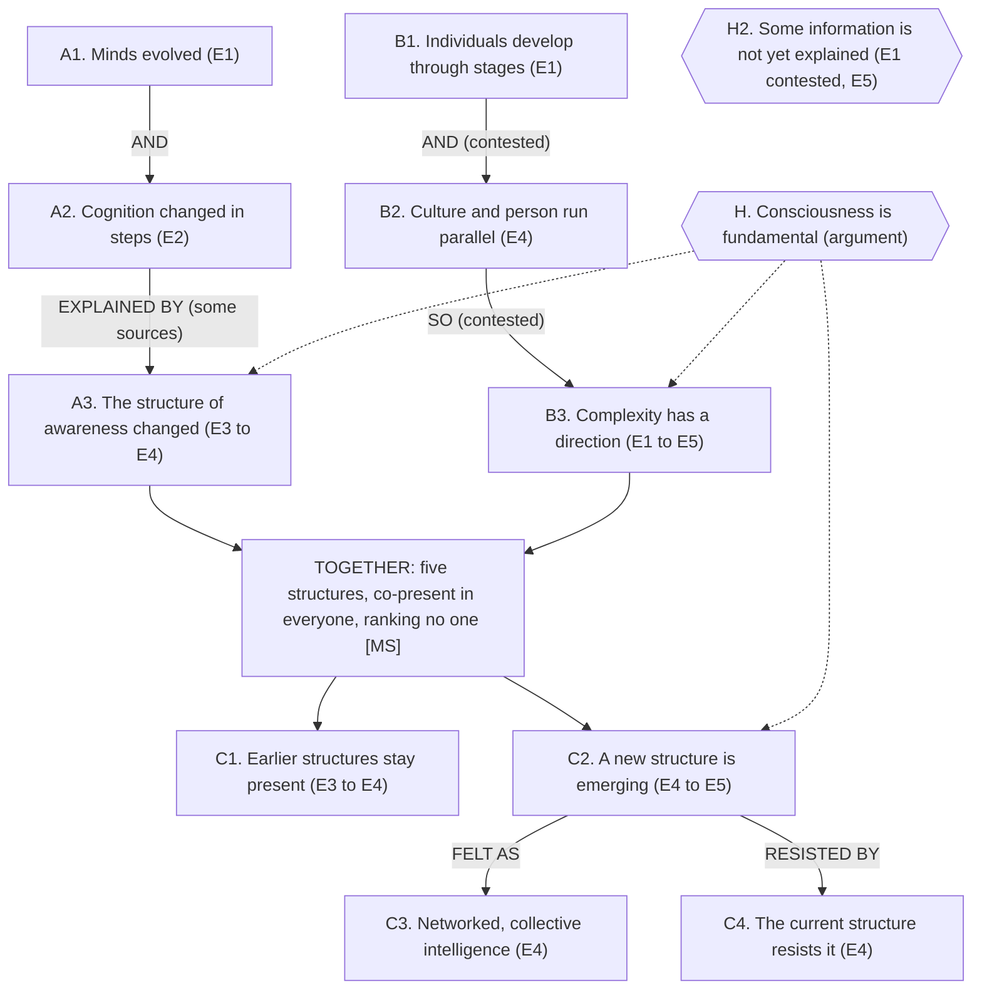

The sources agree that minds evolved, that human cognition changed in dated steps and that earlier modes of mind stay present; they split on whether those steps changed the structure of awareness and on whether complexity has a direction, and the claim that a new, networked structure is emerging now rests on theory and testimony.

## Overview

Has human awareness itself changed over history, and what would show it? This page tests one answer to that question one step at a time. The wiki's [[concepts/major-evolutionary-transitions|Major Evolutionary Transitions]] reads human history as five [[concepts/structures-of-consciousness|structures of consciousness]]: Mimetic, Magical, Mythic, Material and Mycelial. A [[glossary/m-s/structure-of-consciousness|structure of consciousness]] is a shared way of experiencing self, time and world; the term is Jean Gebser's. The five names and the synthesis across them are Michael Haupt's, built on Roger Briggs's *Emerging World* (2021) [MS].

The argument behind that sequence breaks into a chain of twelve claims. For each claim, this page asks two questions: what do the sources say about it, and what kind of evidence does it rest on? Eighty-seven sources take part, from neuroscience and archaeology to contemplative and Indigenous traditions. Critics are in by design. Thirty-one of them, in two row groups, are anomalous experience research and its critics; they joined on 21 November 2026 with step H2 and have no positions yet on the other steps.

The result is uneven. The early steps rest on measured studies and dated finds [IC]. The middle steps rest on theories built from those finds, and the theories disagree. The later steps, about a new structure emerging now, rest on theory and first-person testimony; no measured study in the grid shows the change at population level [IC]. The network's own pages give dates that differ from each other by orders of magnitude, and some of them differ from the dated record.

The grid lives in three sortable tables below. Each source keeps its position on its own page in the [[sources/index|sources]] register; each step of the chain has a page of its own; each dated threshold has a short entry. The companion [[research/evolution-of-consciousness/library|library]] holds the full set of 147 works the grid draws from.

> [!note] How this page describes others
> This page describes authors, the South African San Council, the South African San Institute, the Rock Art Research Institute and other bodies only through what they have published. None has yet been invited to comment. Responses and corrections will be recorded here with their date. On this page `[MS]` marks a claim that comes from Michael Haupt's own project documents.

## The grid's form

The grid lays out a chain of claims, each labelled with the kind of evidence behind it and joined to the next by a connecting word, above a matrix of sources and their positions. 

**Disclosure.** The grid includes critics by design: sixteen sources sit in the critics' row, twenty more in the row of critics of the anomalous experience research, and others dissent on single steps. The wording of the chain is the network's. The TOGETHER step is Michael Haupt's position [MS].

## The distinctions

A change in culture counts as evidence of a change in consciousness only where a source argues the link. A change in what people believe is a change of content; a change in how awareness is organised is a change of structure, which is Gebser's claim. Personal development and cultural history may or may not follow the same order (step B2), and the grid treats that as a claim of its own.

A sequence in time puts structures in order. It puts no living person or people in that order, and this page places none. Where a source does place peoples or nations on a scale, the page reports that the source does so and repeats none of the placements.

The metaphysical question (is consciousness fundamental?) stays apart from the historical one (have its human forms changed?). Gebser, Graves, Kegan, Donald, Briggs and Sahtouris keep their own lineages and terms. "Mycelial" is the network's metaphor for a form of coordination; fungal network science is evidence about fungi.

Each step carries one of five evidence types, the codes the library uses:

| Code | Type | What it means |
|---|---|---|
| E1 | Measured study | Experiment, comparative study or validated instrument, with replication |
| E2 | Dated record | Fossil, archaeological or documentary record with published dating |
| E3 | Theory on evidence | A theory built on reviewed evidence and tested against it |
| E4 | Synthesis or speculation | A framework, synthesis or model with illustrative cases |
| E5 | Tradition or testimony | Contemplative, religious or Indigenous tradition; first-person report |

E5 is a separate kind of knowledge and should not be ranked lower than the others. The grid records which kind each claim rests on, so readers can see it.

## The claim chain

The chain below is the one the research run tested, with its wording refined where the sources showed a step was stated badly. Each step links to its own page, which lists the sources on each side.

The dotted lines mark the three steps that read differently depending on the answer to H. H2 stands apart in the hinge: it asks whether some information reaches minds by routes current science has not explained, and no step of the chain depends on it.

![[evolution-of-consciousness-chain.base]]

The table lists each step with its connecting word, its evidence type, whether it depends on H and the count of grid sources on each side.

## The grid

![[evolution-of-consciousness-grid.base]]

The first tab is the matrix: sources down the side in eleven row groups, steps across the top. ● marks a source that affirms the step, ◐ one that qualifies it and ✕ one that dissents; a blank square means the source is silent on that step. The second tab gives the same matrix in words. One tab per step then lists every source with a position on it, with a sentence on what the source says, where it says it and the grade of that reading. The last two tabs show the critics and Michael Haupt's reading.

Most position codes rest on the works' known arguments and published summaries; a check of tables of contents, excerpts and reviews on 19 November 2026 confirmed or corrected many chapter references, and 67 of the 196 coded squares carry `[TBV]`, either because the passage itself has not been read or because a reading of the text has no independent account beside it yet. Each square also records what its reading was made from: of the 196, 44 rest on a reading of the text, 45 on the work's own abstract, 99 on reviews and reference entries and 8 on summaries. Seventeen of the 67 `[TBV]` squares rest on a reading of the text.

## Step by step

### A1. Minds evolved

Feinberg and Mallatt place sensory consciousness in the Cambrian across vertebrates, arthropods and cephalopods [IC]. Ginsburg and Jablonka use unlimited associative learning as the marker of minimal consciousness [IC]. The New York Declaration on Animal Consciousness, launched at New York University on 19 April 2024, finds "strong scientific support" for consciousness in mammals and birds, and a realistic possibility in all vertebrates and many invertebrates [IC]. Accounts of its first signatories differ (39 in some, 40 on the declaration's own page), and later counts run into the hundreds [TBV]. Dennett and Seth, working from physicalism, agree that consciousness comes in degrees. Michael Levin's framework, TAME, treats cognition as continuous from cells and tissues to whole organisms, with the shaping of a body (morphogenesis) as a basal form of cognition [IC]. Donald Hoffman accepts that selection shaped perception, and denies that the evolved interface shows reality as it is [TBV]. No grid source dissents from A1; the disagreement is over how far down the tree of life awareness goes.

### A2. Human cognition changed in identifiable steps

Merlin Donald describes three transitions: mimetic skill with *Homo erectus*, mythic culture with speech, and theoretic culture with external symbols such as writing [IC]. Robert Bellah builds a history of religion on Donald's stages [IC]. Walter Ong separates oral cultures from literate ones [IC]. Michael Tomasello explains cumulative culture through a ratchet effect, in which each generation keeps what the last one learned [IC]. The dated record (see the dating table) gives this step its strength. The live disputes concern single sites: Martinón-Torres and colleagues reject the claim that *Homo naledi* buried its dead [IC]. Twelve sources affirm the step and one dissents.

### A3. The steps changed the structure of awareness

Here the sources split. Gebser holds that mutations changed how awareness is organised in space and time [IC]. Julian Jaynes argues that introspective consciousness replaced a [[glossary/a-e/bicameral-mind|bicameral mind]] in which commands were heard as the voices of gods [IC]. Owen Barfield traces a move from original participation to the onlooker consciousness of modern science [IC]. Iain McGilchrist ties shifts in Western culture to the balance between the brain's hemispheres [IC]. Ong argues that writing restructures thought [IC].

Donald, Steven Mithen, Terrence Deacon and Robert Bellah describe the same steps as changes in cognitive capacity and memory, and stop short of claims about the structure of awareness [TBV]. Ned Block's review of Jaynes argues that Jaynes mistook a change in the concept of consciousness for a change in consciousness [IC]. Brian Street's study of literacy as social practice rejects the claim that writing restructures thought, and so dissents from A3 as Ong states it [IC]. Nine sources affirm A3, six qualify it and two dissent. It is a theory step: no measured study tests it.

### B1. Individuals develop through stages

Jane Loevinger's ego stages are measured with the Washington University Sentence Completion Test (WUSCT). A meta-analysis by Cohn and Westenberg (2004) pooled 65 studies with more than 9,000 participants: ego level correlates with intelligence at about r = .30 and still adds predictive value of its own [IC]. A 2026 systematic review in *Assessment* by Ryan Coleman and colleagues covered 51 studies and found support for the test's reliability and validity, with results that vary by sample and setting [IC]. The case for Robert Kegan's Subject-Object Interview rests mostly on its own training manual and on practitioner work [TBV]. Spiral Dynamics has no psychometrically validated instrument, and Clare Graves's own data were never published in peer-reviewed form [IC]. Carl Jung describes individuation as a lifelong process of becoming whole, without measured stages [IC]. Steve McIntosh holds that individuals, like cultures, move through a sequence of worldview stages [TBV]. Two measured lines in developmental psychology qualify the stage picture: Robert Siegler's overlapping waves model finds several strategies in use at once, rising and falling gradually [IC], and Kurt Fischer and Thomas Bidell find that a person's skill level shifts with task, context and support [IC].

The [[concepts/structures-of-consciousness|Structures of Consciousness]] page calls the convergence of Gebser, Graves, Kegan and Cook-Greuter "one of the central evidentiary pillars of the corpus" [MS]. Graded through B1 and B2, the pillar holds for individual stages measured with Loevinger's instrument, the line Cook-Greuter extends, and is weak where it reaches for parallels with cultural history.

### B2. Culture and person follow parallel sequences

Don Beck and Christopher Cowan apply the same colour-coded levels to persons, organisations and societies [IC]. Ken Wilber holds individual and cultural development broadly parallel, with stated limits [TBV]. Steve McIntosh treats worldviews as stages of cultural evolution [IC]. David Graeber and David Wengrow reject evolutionary stages of society [IC]. Mithen uses child development only as a cautious analogy and warns against reading it as [[glossary/m-s/recapitulation|recapitulation]], the old idea that each person replays the history of the species [TBV]. No measured study in the grid shows a cultural sequence matching an individual one.

### B3. Complexity has a direction

Eric Chaisson measures energy rate density, the energy flowing through a system per unit of mass, rising from galaxies and stars to plants, animals and societies [IC]. John Maynard Smith and Eörs Szathmáry describe major transitions in how information is stored and passed on, with no necessary direction [IC]. Ilya Prigogine argues that the arrow of time must be rooted in physical dynamics, and that evolution at every level involves instabilities [IC]. Pierre Teilhard de Chardin, Sri Aurobindo and Wilber read a spiritual direction into the rise [IC]. Ervin Laszlo reads evolution in nature and mind as a movement toward coherence [TBV]. Luigi Fantappiè's syntropy (1942) proposes a converging tendency toward order in living systems, symmetrical to entropy; the reference entries on it report no claim that complexity has risen over time, so the grid codes it as qualifying [TBV]. Both stand outside mainstream physics [IC]. Christopher Bache reads the evolution of consciousness as purposeful, on the strength of his own testimony [TBV]. David Ronfeldt's TIMN framework treats rising social complexity as the addition of forms of organisation, and warns against teleology and any presumption that progress is good; the grid codes him as qualifying [TBV]. Stephen Jay Gould argues that apparent progress is spread away from a wall of minimal complexity, with bacteria still the most common form of life [IC]. Karl Popper argues that history has no laws of development [IC]. Peter Medawar rejects Teilhard's directed evolution [TBV]. Tyson Yunkaporta rejects narratives of civilisational progress, in his own terms [IC]. Jeff Meyerhoff argues that Wilber's holarchy carries hidden value judgements and is no neutral ranking of nature [IC]. With ten affirming, seven qualifying and six dissenting, B3 is the most divided step in the grid.

### C1. Earlier structures stay present

Nine sources affirm that earlier modes remain present in everyone, among them Gebser, Donald, Wilber, Kegan, McGilchrist, Ong and Beck and Cowan [IC]. Bellah's refrain that nothing is ever lost applies to capacities such as ritual and narrative, and he concedes that much of the past itself is lost, so the grid codes him as qualifying the step [IC]. Jaynes qualifies the step by reading oracles, possession and voice-hearing as vestiges of the bicameral mind [IC]. Jung qualifies it too: his collective unconscious is an inherited layer active in everyone, a claim about a universal layer more than about historical structures [IC]. Ronfeldt holds that earlier forms of organisation persist and are modified as each new form is added, which the grid reads as qualifying a step about structures of awareness [TBV]. Developmental psychology accepts a weaker form of the step. Siegler finds older and newer strategies coexisting for long periods, with older ones declining and some abandoned [IC]; Fischer and Bidell find lower skill levels available within a range set by context [TBV]. Street treats oral and literate modes as overlapping social practices and rejects the divide on which Ong's residual orality rests; he does not deny that older forms persist, so the grid codes him as qualifying the step (inference) [TBV]. Meyerhoff dissents: he argues that earlier wholes are often destroyed, so Wilber's transcend and include fails as a law [IC]. Nine affirm C1, seven qualify it and one dissents. No source in the grid tests the strong form, that every earlier structure is active in everyone (inference). The Major Evolutionary Transitions page already follows this step: every earlier structure stays active in every person, and the sequence describes which structure dominates coordination at civilisational scale [MS].

### C2. A new structure is emerging now

Gebser's integral structure, Barfield's final participation, Beck and Cowan's [[glossary/m-s/second-tier|second tier]] (after Graves's [[glossary/m-s/momentous-leap|momentous leap]]), Wilber's integral stage, McIntosh's integral worldview, Briggs's planetary consciousness and Aurobindo's supramental consciousness each describe a new structure [IC]. Bache reports, as testimony, visions of a coming transformation of the human species [TBV]. Ong's secondary orality makes a milder claim [IC]. Ronfeldt holds that a fourth form of organisation, the multiorganisational network, is now maturing as the earlier forms did; the grid codes him as qualifying [TBV]. Jaspers denies that modern European science and technology form a second axis, and allows that a remote second Axial Period may still come [IC]. Popper argues that the course of history cannot be predicted, since it depends on the unforeseeable growth of knowledge [IC], and Medawar rejects Teilhard's claim that humanity is converging toward a higher unity of thought [TBV]. Jürgen Habermas argues that the ills of modernity call for a fuller use of reason, and rejects the call for a stage beyond it [IC].

### C3. Its sign is networked, collective intelligence

Teilhard names a [[glossary/m-s/noosphere|noosphere]], a thinking layer enveloping the Earth [IC]. Ronfeldt describes the rising network form as heterarchic, all-channel collaboration among small, dispersed groups, enabled by digital media, and says nothing of collective intelligence [TBV]. Daniel Schmachtenberger calls for collective sensemaking at the scale of present risks, as part of the path he calls the [[glossary/t-z/third-attractor|third attractor]] [TBV]. Yunkaporta presents knowledge held in relations and kinship as long-standing Aboriginal practice, and makes no claim that it marks a new stage; the grid codes him as qualifying C3 for that reason [IC]. Levin holds that every known mind is a collective intelligence of agentic parts, at all scales of life [IC]; on that view collective intelligence is old and widespread, and marks no new stage (inference). Bache describes humanity as a single species mind [TBV].

Measured group intelligence is contested. Woolley and colleagues reported a collective intelligence factor in *Science* (2010) [IC]. Credé and Howardson (2017) found statistical problems on re-analysis, and Bates and Gupta (2017) found that members' intelligence accounted for most of the difference between groups [IC]. On the fungal side, Karst, Jones and Hoeksema (2023) report that the claim that adult trees send resources or warnings to young trees "is not backed up by a single peer-reviewed, published field study" [IC]. That finding bears on [[glossary/a-e/common-mycorrhizal-network|common mycorrhizal networks]] as biology. It leaves [[glossary/m-s/mycelial-consciousness|Mycelial Consciousness]] standing as the network's metaphor.

### C4. The current structure resists it

Gebser's deficient mental-rational phase, McGilchrist's left-hemisphere emphasis, Barfield's literalism, Beck and Cowan's first tier, McIntosh's resistant worldviews and Schmachtenberger's rivalry dynamics all fill this step [IC]. Ronfeldt holds that each new form of organisation subverts the old order before it is added, and that defenders of that order resist it as improper [TBV]. The McGilchrist leg is the most contested. Michael Corballis, a specialist in brain asymmetry, argues that McGilchrist's reading of Western culture reaches well past the neurological facts [IC], and Dan Arnold accepts the hemispheric account and argues that no finding about the brain can carry the verdict on modern culture [IC]. Habermas disputes the premise that rational modernity is a deficient mode holding back a higher one; he does not discuss Gebser or McGilchrist, so the coding is the grid's reading (inference) [TBV]. Albion Butters traces the Spiral Dynamics tiers to Clare Graves's data and reports the criticism they meet [IC]. Six sources affirm C4, three qualify it, two dissent and 76 are silent. All are theory claims.

## The hinge

Step H asks whether consciousness is a basic feature of reality or a product of brains. This is the split over the [[glossary/f-l/hard-problem|hard problem]]: why physical processes come with felt experience at all.

David Chalmers argues that consciousness does not follow logically from the physical and may be a fundamental feature of the world [IC]. Edward Kelly and colleagues argue for a filter model, in which the brain shapes a mind it does not produce [IC]. Donald Hoffman's conscious realism holds that the objective world consists of conscious agents and their experiences [IC]. Teilhard, Aurobindo, Barfield and Wilber hold consciousness basic in their own terms [TBV], and Bache reports direct experience of a living intelligence underlying the universe [TBV]. Laszlo takes an information field in the quantum vacuum as basic, with consciousness among the things it connects [TBV]. Keith Augustine and Michael Martin's collection argues that consciousness depends on a functioning brain [IC]. Daniel Dennett argues that the hard problem rests on intuitions that a "multiple drafts" account of the brain dissolves [IC]. Susan Blackmore, in the library, argues that the felt mystery comes from how brains model themselves [TBV]. Anil Seth sets the hard problem aside for what he calls the real problem, explaining the features of experience through predictive brain processes [IC]. Jaynes, Lewis-Williams, Deacon, Feinberg and Mallatt, and Ginsburg and Jablonka work from naturalism [TBV]. Varela, Thompson and Rosch take a middle way [IC]. Eight sources affirm H, four qualify it and nine dissent. The grid maps the split and leaves it open.

Inference: steps A1, A2, B1, C1, C3 and C4 hold under either answer. A3, B3 and C2 read differently under each. A naturalist reads A3 as a change in cognitive capacity and B3 as a statistical trend; an idealist or panpsychist can read both as consciousness unfolding. On the main scientific theories of consciousness, the question of artificial consciousness turns on the same split: functionalist theories leave room for it, and theories that tie consciousness to living bodies or to a fundamental property make it harder to claim (inference).

### H2. Some information is not yet explained

Step [[research/evolution-of-consciousness/steps/h2-information-not-yet-explained|H2]] asks whether some information reaches minds by routes that current science has not explained: telepathy and precognition in experiments, accurate perception reported during cardiac arrest, and testimony of knowledge received. It was added on 21 November 2026 as the grid wording of [[research/evolution-of-consciousness/anabranch/t2-information-arrives|Anabranch step T2]], and the anomalous experience research and its critics joined the grid with it as row groups 10 and 11. Of the 87 grid sources, 12 affirm it, 9 qualify it and 17 dissent; the other 49 are silent.

The supporters are the experimental and case record and its theorists: Bem's precognition experiments, the meta-analyses of Storm and colleagues and of Mossbridge and colleagues, Cardeña's review, Myers, and Kelly and colleagues [IC]. Laszlo proposes an information field linking minds [IC]; Aurobindo and Gebser hold telepathy real in their own terms, Bache reports insight received in his sessions, and *The Telepathy Tapes* presents testimony [TBV]. Huxley, van Lommel and colleagues and the first AWARE study report or allow such information with limits, and Jung reads a patient's vision as evidence of an inherited collective unconscious [TBV]. Rouder and colleagues find the ganzfeld evidence weaker than its meta-analysis claims, and Weiler and Woollacott call for controlled tests [IC]. The facilitated communication reviews by Schlosser and colleagues, the American Speech-Language-Hearing Association and Hemsley and colleagues find that facilitators author the messages [IC].

The critics argue from failed replication (Ritchie, Wiseman and French), from statistical method (Hyman; Wagenmakers and colleagues), from the dependence of mind on brain (Lamont; Paul Edwards; Augustine and Martin), and from conventional explanations of *The Telepathy Tapes* (Vyse, Boynton, Hupp, Beals, Des Roches Rosa, Delgado-Ron and the Association for Science in Autism Treatment) [IC]. The AWARE II study found no patient who identified its hidden images [IC]. Critics outnumber supporters on this step. Most of the grid's other sources are silent on it: holding consciousness fundamental, or explaining experience through the brain, does not by itself take a position on where information comes from.

## The dating table

![[evolution-of-consciousness-dating.base]]

The first tab groups each source's thresholds by the network structure they sit nearest to, oldest first. The others put every threshold in time order, group them by how well they fit the dated record, and show the network's own pages on their own. The match to a network structure is the grid's reading; each source keeps its own terms.

What the table shows:

1. **Mimetic.** Michael Haupt's working page dates Mimetic to about 3.5 million years ago [MS]. That is earlier than the oldest dated stone tools, 3.3 million years old at Lomekwi 3 in Kenya (Harmand and colleagues, 2015), and earlier than the first *Homo* fossils at about 2.8 million years [IC]. Donald's précis places the mimetic transition near the appearance of *Homo erectus*, about 1.5 million years ago; secondary summaries give about 2 million [IC]. Briggs starts his Mimetic stage about 3 million years ago with the first manufactured stone tools, consistent with the record (*Emerging World*, ch. 4, p. 152) [TBV].
2. **Magical.** The working page's 1 million years matches fire at Wonderwerk Cave at about 1 million years (Berna and colleagues, 2012). A 2026 study by Marin-Monfort and colleagues in *PLOS One* reports burnt bone at Wonderwerk dated 1.07 to 1.79 million years ago [IC]. Briggs also starts his Magical stage about 1 million years ago, and ties it to *Homo heidelbergensis* (ch. 4, pp. 128, 152) [TBV].
3. **Mythic.** The working page's 70,000 years is later than pigment use at Pinnacle Point, about 164,000 years ago, and close to the Blombos drawing at about 73,000 years [IC]. A Framer OS glossary gives 100,000 to 70,000 years, and an older document about 60,000 [MS]. Briggs dates his Mythical stage to the Great Leap, about 60,000 years ago, later than the Pinnacle Point record (ch. 4, pp. 124, 152) [TBV].
4. **Material.** The network dates it three ways. The working page puts it at the Neolithic, about 12,000 years ago. The Major Evolutionary Transitions page ties it to the scientific revolution and the last several centuries, and places Mythic with the great civilisations of antiquity (Egypt, Sumer, Babylon). Briggs dates his Material stage to the first civilisations, about 5,000 years ago (*Emerging World*, ch. 5, p. 166) [TBV]. Jaspers places the [[glossary/a-e/axial-age|Axial Age]] at about 800 to 200 BCE [IC].
5. **Mycelial.** No dated marker exists, and no measured study shows the change.

The widest gap is inside the network. The Major Evolutionary Transitions page maps the first three transitions, Mimetic through to Material, onto the [[glossary/m-s/s-curve|logistic growth curve]] of civilisation since the Neolithic Revolution, about 12,000 years ago [MS]. On that reading, Magical and Mythic begin within the last 12,000 years. The working page starts them a million and 70,000 years ago. Inference: the two pages may be dating different things. The working page dates when a capacity first appears; the Major Evolutionary Transitions page dates when a structure comes to lead coordination at civilisational scale. Both readings can stand, once each page says which one it gives. On 20 November 2026 the Major Evolutionary Transitions page was revised to say so: it now gives the record's dates for each structure's first appearance, and uses the curve for which structure leads coordination at scale.

Sources disagree on when Material begins because each counts a different defining capacity: farming, writing, reflective thought or experimental science (inference).

## Place: the Southern African record

Southern Africa holds some of the deepest dated record of the human mind [IC].

**Blombos Cave**, on the southern Cape coast, has Middle Stone Age levels of about 100,000 to 72,000 years. A cross-hatched ochre drawing on a silcrete flake is dated to about 73,000 years; Henshilwood and colleagues report it as the oldest known drawing [IC]. The same levels yield shell beads and engraved ochre [IC].

**Pinnacle Point**, near Mossel Bay: Marean and colleagues (2007) report shellfish collection, small stone bladelets and worked pigment at about 164,000 years ago, give or take 12,000 [IC].

**Wonderwerk Cave**, in the Northern Cape: Berna and colleagues (2012) report fire about 1 million years ago in Acheulean levels. Marin-Monfort and colleagues (2026) extend the range to 1.07 to 1.79 million years. The study describes the use of fire brought into the cave; it does not show that the hominins there could make fire [IC]. The work is carried out with the McGregor Museum, Kimberley, under permit from the South African Heritage Resources Agency [IC].

**The Cradle of Humankind**: Lee Berger and colleagues argue that *Homo naledi*, a small-brained hominin from the Rising Star cave system, buried its dead [IC]. The journal *eLife* published the work with split reviews: its 2023 version was assessed as inadequate, and in the 2025 version one reviewer judged burial convincingly shown while another judged the evidence incomplete [IC]. Martinón-Torres and colleagues argue that the evidence establishes neither burial nor rock art [IC]. This page gives no location for the burial or rock art sites beyond what the official heritage record publishes.

**San rock art**: David Lewis-Williams and the Rock Art Research Institute at the University of the Witwatersrand link San rock art to trance and altered states [IC]. Anne Solomon argues that this reading mistakes accounts of spirits and mythological beings for accounts of trance; Pippa Skotnes and Michael Wessels also dispute his reading of the /Xam texts [IC].

**San knowledge** is held by San communities and their institutions, among them the South African San Council, the South African San Institute and !Khwa ttu. The San Code of Research Ethics (2017) asks researchers to commit to respect, honesty, justice and fairness, and care, through a community approval process [IC]. This page does not translate San knowledge into the network's structure names.

What the record adds: it puts dated fire and symbolic behaviour well before the dates most sequence theorists use, and it shows European cave art as a late part of the symbolic record (inference).

## Ten propositions

**P1. The evidence that awareness exists in graded forms across many animal lineages is strong and broadly accepted.** For: the 2024 Declaration; Feinberg and Mallatt; Ginsburg and Jablonka [IC]. Against: outside mammals and birds, the Declaration claims a realistic possibility, short of strong support. Grade: supported, with that qualification [IC]. The wiki can say: the evidence is strong for mammals and birds, and a realistic possibility for other vertebrates and many invertebrates.

**P2. Donald's dates and the dated hominin record place the first threshold later than 3.5 million years ago.** For: Donald ties [[glossary/m-s/mimetic-culture|mimetic culture]] to *Homo erectus*; *Homo* appears about 2.8 million years ago [IC]. Against: the Lomekwi tools, at 3.3 million years, are older than *Homo*, so stone-tool use is older than Donald's mimetic stage. Grade: supported [IC]. The wiki can say: on Donald's dating, the first threshold falls between about 2 and 1.5 million years ago.

**P3. The Southern African record moves the earliest dated evidence for fire use and symbolic behaviour earlier than the dates most sequence theorists use.** For: Pinnacle Point pigment at about 164,000 years; the Blombos drawing at about 73,000; Wonderwerk fire up to 1.79 million [IC]. Against: the older Wonderwerk range comes from one 2026 study, and a date of 1 million years for fire already matches the working page. Grade: supported for symbolic behaviour, partly supported for fire [IC]. The wiki can say: Southern African sites put symbolic behaviour well before 70,000 years ago.

**P4. Stage models of individual adult development have measured support; stage models of cultural history mostly do not.** For: the evidence base for the WUSCT; the absence of any measured study of cultural stages in the grid [IC]. Against: the support for Kegan's interview rests mostly on its own manual, and Spiral Dynamics has no validated instrument. Grade: partly supported [IC]. The wiki can say: one adult-development instrument has strong measured support; cultural stage models have none.

**P5. Evidence on early cities and social forms contradicts any single linear sequence of social forms, while leaving room for sequences of cognitive capacity.** For: Graeber and Wengrow's *The Dawn of Everything* (2021) [IC]. Against: the case rests largely on one major synthesis, and the room it leaves for cognitive sequences is inference. Grade: partly supported [TBV]. The wiki can say: the archaeology of early towns challenges single linear sequences of social forms.

**P6. Most sequence theorists hold that earlier structures remain present, and this is the most widely shared step among them.** For: nine grid sources affirm C1 [IC]. Against: the support is theoretical; measured developmental work supports only a weaker form, in which older ways of thinking coexist with newer ones for a time, one critic dissents from a named affirmer, and Street and Bellah qualify the step [IC]. Grade: supported for the sequence theorists, contested in its strong form [IC]. The wiki can say: co-presence is the most widely shared step among sequence theorists, and the measured record supports it only in a weaker form.

**P7. Claims that a new structure is emerging rest on theory and testimony; no measured study shows a population-level change of the kind the earlier transitions describe.** For: no study in the grid shows such a change, and the measured collective intelligence factor is contested [IC]. Against: none found. Grade: supported [IC]. The wiki can say: the emerging-structure claim rests on theory and testimony.

**P8. The popular account of the "wood wide web" outruns the field evidence, and the network's use of mycelium is safe as metaphor and unsafe as biology.** For: Karst, Jones and Hoeksema (2023) [IC]. Against: Simard's field work shows some fungal links and transfers between trees [TBV]. Grade: supported [IC]. The wiki can say: mycelium is the network's metaphor for a form of coordination.

**P9. Steps A1, A2, B1 and C1 hold whether or not consciousness is fundamental; steps A3, B3 and C2 depend on the answer, or are read differently under each answer.** For: the coding of the hinge above (inference). Against: panpsychists frame A1 differently. Grade: partly supported [TBV]. The wiki can say: the historical steps can stand without settling the hard problem.

**P10. Sources disagree on when Material begins, and the disagreement is about what each counts as the defining capacity.** For: the dating table, including the network's own pages [IC]. Against: none found. Grade: supported, with the explanation marked as inference [IC]. The wiki can say: sources date Material differently because they define it by different capacities.

## Evidence the claims must face

**Teleology.** Gould argues that evolution shows spread away from a minimum of complexity, with no drive toward more of it. Popper argues that history has no laws of development that would let anyone predict its next stage. Medawar rejects Teilhard's direction as lacking biological support. Each modern sequence that claims a direction (Teilhard, Aurobindo, Wilber, McIntosh) states it as philosophy or spirituality, and Chaisson's measure describes a trend without any claim about consciousness [IC].

**Ranking.** Nineteenth-century social evolutionism ranked peoples by stage [TBV]. Gebser declines to read his mutations as progress [TBV]. Wilber states limits on his parallels [TBV]. Spiral Dynamics applies its colours to cultures, and Ronfeldt's 1996 TIMN paper assigns named countries and groups to its types of society; this page reports that they do so and repeats none of the placements. The network's rule is co-presence in every person, ranking no one [MS].

**Eurocentrism.** Gebser, Jaynes, Barfield and McGilchrist draw mostly on European and Near Eastern records [IC]. The Southern African dates put symbolic behaviour far earlier than European cave art [IC]. Jaspers includes China, India and Iran. Little in the grid tests the sequences against the Americas or Australia, and that gap stays open.

**Measurement.** See B1. David Hawkins's Map of Consciousness rests on [[glossary/a-e/applied-kinesiology|applied kinesiology]], a muscle-testing method, and has no peer-reviewed validation in the library [TBV]. Hawkins calibrates nations and groups; this page reports that and repeats none of it.

**Contested sources.** Jaynes's bicameral mind is reported above with Block's rejection; the Julian Jaynes Society replies that the change concerns mentality as lived [TBV]. Rupert Sheldrake, Hawkins and Graham Hancock are in the library and outside the grid; most specialists in their fields reject their central claims. Laszlo's Akashic field and Fantappiè's syntropy sit outside mainstream physics, and Bache's claims rest on his own testimony; the grid codes each in its own terms and grades the reading.

**The hard-problem split.** Dennett and Blackmore argue that the felt mystery of experience comes from how brains model themselves. Chalmers and Kelly argue that experience cannot be derived from function. The grid maps both.

## Companion page

[[research/evolution-of-consciousness/library|The Evolution of Consciousness: A Graded Library]]

## Related

- [[concepts/major-evolutionary-transitions|Major Evolutionary Transitions]]
- [[concepts/structures-of-consciousness|Structures of Consciousness]]
- [[concepts/the-momentous-leap|The Momentous Leap]]
- [[concepts/convergences|Convergences]]
- [[people/theorists/briggs-roger|Roger Briggs]]
- [[research/evolution-of-consciousness/steps/index|The claim chain, step by step]]
- [[research/evolution-of-consciousness/dates/index|Dated thresholds]]

## Sources

### The dated record and the Southern African record

- Berger, L. R. et al. (2025). Evidence for deliberate burial of the dead by *Homo naledi*. *eLife* 12: RP89106. [[sources/berger-2025-deliberate-burial-homo-naledi|Source page]]
- Berna, F. et al. (2012). Microstratigraphic evidence of in situ fire in the Acheulean strata of Wonderwerk Cave, Northern Cape province, South Africa. *PNAS* 109(20): E1215-E1220. https://doi.org/10.1073/pnas.1117620109
- Harmand, S. et al. (2015). 3.3-million-year-old stone tools from Lomekwi 3, West Turkana, Kenya. *Nature* 521: 310-315. https://doi.org/10.1038/nature14464
- Henshilwood, C. S. et al. (2018). An abstract drawing from the 73,000-year-old levels at Blombos Cave, South Africa. *Nature* 562: 115-118. [[sources/henshilwood-2018-abstract-drawing-blombos|Source page]]
- Lewis-Williams, J. D. and Pearce, D. G. (2012). The southern San and the trance dance. *Antiquity* 86: 696-706.
- Marean, C. W. et al. (2007). Early human use of marine resources and pigment in South Africa during the Middle Pleistocene. *Nature* 449: 905-908. https://doi.org/10.1038/nature06204
- Marin-Monfort, M. D. et al. (2026). New evidence for Early Pleistocene use of fire at Wonderwerk Cave (South Africa). *PLOS One* 21(6): e0347480.
- Martinón-Torres, M. et al. (2024). No scientific evidence that *Homo naledi* buried their dead and produced rock art. *Journal of Human Evolution*. [[sources/martinon-torres-2024-no-evidence-naledi|Source page]]
- Solomon, A. (2013). The death of trance: recent perspectives on San ethnographies and rock arts. *Antiquity* 87.
- South African San Council (2017). *San Code of Research Ethics*. [[sources/sasc-2017-san-code-of-research-ethics|Source page]]

### Measurement and collective intelligence

- Bates, T. C. and Gupta, S. (2017). Smart groups of smart people: evidence for IQ as the origin of collective intelligence in the performance of human groups. *Intelligence* 60: 46-56.
- Cohn, L. D. and Westenberg, P. M. (2004). Intelligence and maturity: meta-analytic evidence for the incremental and discriminant validity of Loevinger's measure of ego development. *Journal of Personality and Social Psychology* 86(5): 760-772.
- Credé, M. and Howardson, G. (2017). The structure of group task performance: a second look at "collective intelligence". *Journal of Applied Psychology* 102: 1483-1492.
- Karst, J., Jones, M. D. and Hoeksema, J. D. (2023). Positive citation bias and overinterpreted results lead to misinformation on common mycorrhizal networks in forests. *Nature Ecology and Evolution* 7(4): 501-511. [[sources/karst-2023-positive-citation-bias|Source page]]
- Manners, J. and Durkin, K. (2001). A critical review of the validity of ego development theory and its measurement. *Journal of Personality Assessment* 77(3): 541-567.
- Coleman, R., Jennings, C., Pettit, M., Billeiter, K., Benson, N., Dombrowski, S. and Austin, T. (2026). Sentence completion tests with an empirical foundation: a systematic review. *Assessment*, online 30 March 2026. https://doi.org/10.1177/10731911261430262
- Woolley, A. W. et al. (2010). Evidence for a collective intelligence factor in the performance of human groups. *Science* 330: 686-688.

### The grid sources

- Kristin Andrews, Jonathan Birch, Jeff Sebo et al. (2024). *The New York Declaration on Animal Consciousness*. New York University (19 April 2024). [[sources/andrews-birch-sebo-2024-new-york-declaration|Source page]]
- Dan Arnold (2019). *Where in the Brain Does Buddhism Come From? Critical Thoughts Regarding Iain McGilchrist's Reflections on Religion*. Religion, Brain and Behavior 9(4): 345-362. [[sources/arnold-2019-where-in-the-brain-does-buddhism-come-from|Source page]]
- Association for Science in Autism Treatment (2025). *ASAT Responds to The Skeptical Inquirer: 'The Telepathy Tapes: A Dangerous Cornucopia of Pseudoscience'*. Association for Science in Autism Treatment, Media Watch, 27 January 2025. [[sources/asat-2025-responds-to-telepathy-tapes-review|Source page]]
- American Speech-Language-Hearing Association (2018). *Facilitated Communication [Position Statement]*. ASHA, PS2018-00352. [[sources/asha-2018-facilitated-communication|Source page]]
- Keith Augustine; Michael Martin (2015). *The Myth of an Afterlife: The Case against Life After Death*. Rowman & Littlefield, Lanham, MD. [[sources/augustine-martin-2015-myth-of-an-afterlife|Source page]]
- Sri Aurobindo (1939). *The Life Divine*. Arya Publishing House, Calcutta, 1939 (vol. I) and 1940 (vol. II). [[sources/aurobindo-1939-the-life-divine|Source page]]
- Christopher M. Bache (2019). *LSD and the Mind of the Universe: Diamonds from Heaven*. Park Street Press, Rochester, Vermont; foreword by Ervin Laszlo. [[sources/bache-2019-lsd-and-the-mind-of-the-universe|Source page]]
- Owen Barfield (1957). *Saving the Appearances*. Faber & Faber. [[sources/barfield-1957-saving-the-appearances|Source page]]
- Katharine Beals (2026). *Telepathy via Facilitated Communication in Profound Autism: A 21st Century Delusion*. Skeptical Inquirer 50(5), September/October 2026. [[sources/beals-2026-telepathy-via-facilitated-communication|Source page]]
- Don Edward Beck and Christopher C. Cowan (1996). *Spiral Dynamics*. Blackwell Publishers. [[sources/beck-cowan-spiral-dynamics|Source page]]
- Robert N. Bellah (2011). *Religion in Human Evolution*. Belknap Press of Harvard University Press. [[sources/bellah-2011-religion-in-human-evolution|Source page]]
- Daryl J. Bem (2011). *Feeling the Future: Experimental Evidence for Anomalous Retroactive Influences on Cognition and Affect*. Journal of Personality and Social Psychology 100(3): 407-425. [[sources/bem-2011-feeling-the-future|Source page]]
- Ned Block (1981). *Review of The Origin of Consciousness in the Breakdown of the Bicameral Mind*. Cognition and Brain Theory 4(1): 81-83. [[sources/block-1981-review-of-jaynes|Source page]]
- Janyce L. Boynton (2026). *Debunking The Telepathy Tapes: The Role of Facilitator Behaviors*. Skeptical Inquirer 50(5). [[sources/boynton-2026-debunking-telepathy-tapes|Source page]]
- Roger P. Briggs (2021). *Emerging World: The Evolution of Consciousness and the Future of Humanity*. Atlantic Publishing Group. [[sources/briggs-2021-emerging-world|Source page]]
- Albion M. Butters (2015). *A Brief History of Spiral Dynamics*. Approaching Religion 5(2): 67-78. [[sources/butters-2015-brief-history-of-spiral-dynamics|Source page]]
- Etzel Cardeña (2018). *The Experimental Evidence for Parapsychological Phenomena: A Review*. American Psychologist 73(5): 663-677. [[sources/cardena-2018-experimental-evidence-psi|Source page]]
- Eric J. Chaisson (2001). *Cosmic Evolution*. Harvard University Press. [[sources/chaisson-2001-cosmic-evolution|Source page]]
- David J. Chalmers (1996). *The Conscious Mind*. Oxford University Press. [[sources/chalmers-1996-the-conscious-mind|Source page]]
- Michael C. Corballis (2014). *Left Brain, Right Brain: Facts and Fantasies*. PLoS Biology 12(1): e1001767. [[sources/corballis-2014-left-brain-right-brain|Source page]]
- Terrence W. Deacon (1997). *The Symbolic Species*. W. W. Norton. [[sources/deacon-1997-the-symbolic-species|Source page]]
- Jorge Andrés Delgado-Ron (2026). *Response to Weiler and Woollacott, 2025*. Explore 22(3): 103387 (Elsevier). [[sources/delgado-ron-2026-response-to-weiler-and-woollacott|Source page]]
- Daniel C. Dennett (1991). *Consciousness Explained*. Little Brown. [[sources/dennett-1991-consciousness-explained|Source page]]
- Shannon Des Roches Rosa (2026). *The Telepathy Tapes Is Such A Hot Mess*. Thinking Person's Guide to Autism. [[sources/des-roches-rosa-2026-telepathy-tapes-hot-mess|Source page]]
- Ky Dickens (2024). *The Telepathy Tapes*. The Telepathy Tapes (audio podcast). [[sources/dickens-2024-telepathy-tapes|Source page]]
- Merlin Donald (1991). *Origins of the Modern Mind*. Harvard University Press. [[sources/donald-1991-origins-of-the-modern-mind|Source page]]
- Paul Edwards (ed.) (1992). *Immortality*. Macmillan, New York. [[sources/edwards-1992-immortality|Source page]]
- Paul Edwards (1996). *Reincarnation: A Critical Examination*. Prometheus Books, Amherst, NY. [[sources/edwards-1996-reincarnation-critical-examination|Source page]]
- Luigi Fantappiè (1942). *Principi di una teoria unitaria del mondo fisico e biologico*. Rome: Società Editrice Humanitas Nova, 1944 (134 pp.); reprinted by Di Renzo Editore, Rome, 1993. Theory presented to the Accademia d'Italia, 30 October 1942. [[sources/fantappie-1942-unitary-theory-of-the-physical-and-biological-world|Source page]]
- Todd E. Feinberg, Jon M. Mallatt (2016). *The Ancient Origins of Consciousness*. MIT Press. [[sources/feinberg-mallatt-2016-ancient-origins|Source page]]
- Kurt W. Fischer and Thomas R. Bidell (2006). *Dynamic Development of Action and Thought*. In R. M. Lerner (ed.), *Theoretical Models of Human Development*, Handbook of Child Psychology, 6th edition, volume 1, Wiley, ch. 7, pp. 313-399. [[sources/fischer-bidell-2006-dynamic-development|Source page]]
- Jean Gebser (1949). *The Ever-Present Origin*. Ohio University Press (English translation, 1985). [[sources/gebser-ever-present-origin|Source page]]
- Simona Ginsburg, Eva Jablonka (2019). *The Evolution of the Sensitive Soul*. MIT Press. [[sources/ginsburg-jablonka-2019-sensitive-soul|Source page]]
- Stephen Jay Gould (1996). *Full House*. Harmony Books. [[sources/gould-1996-full-house|Source page]]
- David Graeber, David Wengrow (2021). *The Dawn of Everything*. Allen Lane. [[sources/graeber-wengrow-2021-dawn-of-everything|Source page]]
- Jürgen Habermas (1985). *The Philosophical Discourse of Modernity: Twelve Lectures*. Suhrkamp; English translation, MIT Press, 1987. [[sources/habermas-1985-philosophical-discourse-of-modernity|Source page]]
- Bronwyn Hemsley; Lucy Bryant; Ralf W. Schlosser; Howard C. Shane; Russell Lang; Diane Paul; Meher Banajee; Marie Ireland (2018). *Systematic review of facilitated communication 2014-2018 finds no new evidence that messages delivered using facilitated communication are authored by the person with disability*. Autism & Developmental Language Impairments 3: 1-8. [[sources/hemsley-2018-systematic-review-facilitated-communication|Source page]]
- Donald D. Hoffman (2019). *The Case Against Reality: Why Evolution Hid the Truth from Our Eyes*. W. W. Norton, New York. [[sources/hoffman-2019-the-case-against-reality|Source page]]
- Stephen Hupp (2026). *How The Telepathy Tapes Silences Voices*. Skeptical Inquirer 50(5), September/October 2026. [[sources/hupp-2026-how-the-telepathy-tapes-silences-voices|Source page]]
- Aldous Huxley (1954). *The Doors of Perception*. [[sources/huxley-1954-doors-of-perception|Source page]]
- Ray Hyman (2010). *Meta-Analysis That Conceals More Than It Reveals: Comment on Storm et al. (2010)*. Psychological Bulletin 136(4): 486-490. [[sources/hyman-2010-meta-analysis-conceals|Source page]]
- Karl Jaspers (1949). *The Origin and Goal of History*. R. Piper & Co., Munich, and Artemis-Verlag, Zurich; English translation by Michael Bullock, Routledge & Kegan Paul, 1953. [[sources/jaspers-1949-origin-and-goal-of-history|Source page]]
- Julian Jaynes (1976). *The Origin of Consciousness in the Breakdown of the Bicameral Mind*. Houghton Mifflin. [[sources/jaynes-1976-origin-of-consciousness|Source page]]
- C. G. Jung (1959). *The Archetypes and the Collective Unconscious*. Princeton University Press, Bollingen Series XX, Collected Works volume 9, part 1; translated by R. F. C. Hull; second edition 1969. [[sources/jung-1959-archetypes-and-the-collective-unconscious|Source page]]
- Justine Karst, Melanie D. Jones, Jason D. Hoeksema (2023). *Positive citation bias and overinterpreted results lead to misinformation on common mycorrhizal networks in forests*. Nature Ecology & Evolution 7(4): 501-511. https://doi.org/10.1038/s41559-023-01986-1 [[sources/karst-2023-positive-citation-bias|Source page]]
- Robert Kegan (1982). *The Evolving Self*. Harvard University Press. [[sources/kegan-1982-the-evolving-self|Source page]]
- Edward F. Kelly, Emily Williams Kelly et al. (2007). *Irreducible Mind*. Rowman & Littlefield. [[sources/kelly-2007-irreducible-mind|Source page]]
- Corliss Lamont (1935). *The Illusion of Immortality*. G. P. Putnam's Sons, New York. [[sources/lamont-1935-illusion-of-immortality|Source page]]
- Ervin Laszlo (2004). *Science and the Akashic Field: An Integral Theory of Everything*. Inner Traditions, Rochester, Vermont; updated second edition 2007. [[sources/laszlo-2004-science-and-the-akashic-field|Source page]]
- Michael Levin (2022). *Technological Approach to Mind Everywhere: An Experimentally-Grounded Framework for Understanding Diverse Bodies and Minds*. Frontiers in Systems Neuroscience 16: 768201. https://doi.org/10.3389/fnsys.2022.768201 [[sources/levin-2022-technological-approach-to-mind-everywhere|Source page]]
- David Lewis-Williams (2002). *The Mind in the Cave*. Thames & Hudson. [[sources/lewis-williams-2002-mind-in-the-cave|Source page]]
- Jane Loevinger (1976). *Ego Development*. Jossey-Bass. [[sources/loevinger-1976-ego-development|Source page]]
- María Martinón-Torres, Diego Garate, Andy I. R. Herries, Michael D. Petraglia (2024). *No scientific evidence that Homo naledi buried their dead and produced rock art*. Journal of Human Evolution 103464. [[sources/martinon-torres-2024-no-evidence-naledi|Source page]]
- John Maynard Smith, Eörs Szathmáry (1995). *The Major Transitions in Evolution*. W. H. Freeman. [[sources/maynard-smith-szathmary-1995-major-transitions|Source page]]
- Iain McGilchrist (2009). *The Master and His Emissary*. Yale University Press. [[sources/mcgilchrist-2009-master-and-his-emissary|Source page]]
- Steve McIntosh (2007). *Integral Consciousness and the Future of Evolution*. Paragon House, St. Paul, Minnesota. [[sources/mcintosh-2007-integral-consciousness|Source page]]
- Peter B. Medawar (1961). *Review of The Phenomenon of Man*. Mind 70(277): 99-106. [[sources/medawar-1961-review-phenomenon-of-man|Source page]]
- Jeff Meyerhoff (2010). *Bald Ambition: A Critique of Ken Wilber's Theory of Everything*. Inside the Curtain Press. [[sources/meyerhoff-2010-bald-ambition|Source page]]
- Steven Mithen (1996). *The Prehistory of the Mind*. Thames & Hudson. [[sources/mithen-1996-prehistory-of-the-mind|Source page]]
- Julia Mossbridge; Patrizio Tressoldi; Jessica Utts (2012). *Predictive Physiological Anticipation Preceding Seemingly Unpredictable Stimuli: A Meta-Analysis*. Frontiers in Psychology 3: 390. [[sources/mossbridge-tressoldi-utts-2012-predictive-physiological-anticipation|Source page]]
- F. W. H. Myers (1903). *Human Personality and Its Survival of Bodily Death*. Longmans, Green, London, 2 vols; abridged edition ed. L. H. Myers, Longmans, Green, 1906. [[sources/myers-1903-human-personality|Source page]]
- Walter J. Ong (1982). *Orality and Literacy*. Methuen. [[sources/ong-1982-orality-and-literacy|Source page]]
- Sam Parnia; Ken Spearpoint; Gabriele de Vos; Peter Fenwick; and colleagues (2014). *AWARE—AWAreness during REsuscitation—A prospective study*. Resuscitation 85(12): 1799-1805. [[sources/parnia-2014-aware|Source page]]
- Sam Parnia; Tara Keshavarz Shirazi; Jignesh Patel; and colleagues (2023). *AWAreness during REsuscitation - II: A Multi-Center Study of Consciousness and Awareness in Cardiac Arrest*. Resuscitation 191: 109903. [[sources/parnia-2023-aware-ii|Source page]]
- Karl Popper (1957). *The Poverty of Historicism*. Routledge & Kegan Paul, London. [[sources/popper-poverty-of-historicism|Source page]]
- Ilya Prigogine (1996). *The End of Certainty: Time, Chaos, and the New Laws of Nature*. Éditions Odile Jacob, Paris, in collaboration with Isabelle Stengers; English edition, Free Press, New York, 1997. [[sources/prigogine-1996-the-end-of-certainty|Source page]]
- Arthur S. Reber; James E. Alcock (2020). *Searching for the Impossible: Parapsychology's Elusive Quest*. American Psychologist 75(3): 391-399. [[sources/reber-alcock-2020-searching-for-the-impossible|Source page]]
- Stuart J. Ritchie; Richard Wiseman; Christopher C. French (2012). *Failing the Future: Three Unsuccessful Attempts to Replicate Bem's 'Retroactive Facilitation of Recall' Effect*. PLoS ONE 7(3): e33423. [[sources/ritchie-wiseman-french-2012-failing-the-future|Source page]]
- David Ronfeldt (1996). *Tribes, Institutions, Markets, Networks: A Framework About Societal Evolution*. RAND Corporation, Santa Monica, P-7967. [[sources/ronfeldt-timn|Source page]]
- Jeffrey N. Rouder; Richard D. Morey; Jordan M. Province (2013). *A Bayes Factor Meta-Analysis of Recent Extrasensory Perception Experiments: Comment on Storm, Tressoldi, and Di Risio (2010)*. Psychological Bulletin 139(1): 241-247. [[sources/rouder-morey-province-2013-bayes-factor-meta-analysis|Source page]]
- Ralf W. Schlosser; Susan Balandin; Bronwyn Hemsley; Teresa Iacono; Paul Probst; Stephen von Tetzchner (2014). *Facilitated Communication and Authorship: A Systematic Review*. Augmentative and Alternative Communication 30(4): 359-368. [[sources/schlosser-2014-facilitated-communication-authorship|Source page]]
- Daniel Schmachtenberger (2022). *In Search of the Third Attractor (parts 1 and 2)*. Rebel Wisdom, hosted by David Fuller (part 1, August 2022; part 2, 23 August 2022). [[sources/schmachtenberger-2022-third-attractor|Source page]]
- Anil Seth (2021). *Being You*. Faber & Faber. [[sources/seth-2021-being-you|Source page]]
- Robert S. Siegler (1996). *Emerging Minds: The Process of Change in Children's Thinking*. Oxford University Press. [[sources/siegler-1996-emerging-minds|Source page]]
- Suzanne Simard (2021). *Finding the Mother Tree*. Alfred A. Knopf, New York. [[sources/simard-2021-finding-the-mother-tree|Source page]]
- Lance Storm; Patrizio E. Tressoldi; Lorenzo Di Risio (2010). *Meta-analysis of free-response studies, 1992-2008: Assessing the noise reduction model in parapsychology*. Psychological Bulletin 136(4): 471-485. [[sources/storm-tressoldi-di-risio-2010-meta-analysis-free-response|Source page]]
- Brian V. Street (1984). *Literacy in Theory and Practice*. Cambridge University Press. [[sources/street-1984-literacy-in-theory-and-practice|Source page]]
- Pierre Teilhard de Chardin (1955). *The Phenomenon of Man*. Éditions du Seuil; English: Collins. [[sources/teilhard-1955-the-phenomenon-of-man|Source page]]
- Michael Tomasello (1999). *The Cultural Origins of Human Cognition*. Harvard University Press. [[sources/tomasello-1999-cultural-origins|Source page]]
- Pim van Lommel; Ruud van Wees; Vincent Meyers; Ingrid Elfferich (2001). *Near-death experience in survivors of cardiac arrest: a prospective study in the Netherlands*. The Lancet 358(9298): 2039-2045. [[sources/van-lommel-2001-near-death-experience-cardiac-arrest|Source page]]
- Francisco J. Varela, Evan Thompson, Eleanor Rosch (1991). *The Embodied Mind*. MIT Press. [[sources/varela-thompson-rosch-1991-embodied-mind|Source page]]
- Stuart Vyse (2025). *The Telepathy Tapes: A Dangerous Cornucopia of Pseudoscience*. Skeptical Inquirer, 6 January 2025. [[sources/vyse-2025-telepathy-tapes|Source page]]
- Stuart Vyse (2026). *The Telepathy Tapes: A Portal into a World of Woo*. Skeptical Inquirer 50(5), September/October 2026. [[sources/vyse-2026-portal-into-world-of-woo|Source page]]
- Eric-Jan Wagenmakers; Ruud Wetzels; Denny Borsboom; Han L. J. van der Maas (2011). *Why Psychologists Must Change the Way They Analyze Their Data: The Case of Psi: Comment on Bem (2011)*. Journal of Personality and Social Psychology 100(3): 426-432. [[sources/wagenmakers-2011-why-psychologists-must-change|Source page]]
- Marina Weiler; Marjorie Woollacott (2025). *Rethinking communication and consciousness: Lessons from the telepathy tapes podcast*. Explore 21(6): 103271 (Elsevier). [[sources/weiler-woollacott-2025-rethinking-communication-and-consciousness|Source page]]
- Ken Wilber (2000). *Integral Psychology: Consciousness, Spirit, Psychology, Therapy*. Shambhala. [[sources/wilber-2000-integral-psychology|Source page]]
- Tyson Yunkaporta (2019). *Sand Talk*. Text Publishing. [[sources/yunkaporta-2019-sand-talk|Source page]]

### The network's own documents

- Michael Haupt, working page "Evolution of Consciousness" (Roam), as summarised in the Run 2 research instructions [MS].
- Michael Haupt, Framer OS and Crisis Codes Glossary (Google Drive, December 2025) [MS].
- [[concepts/major-evolutionary-transitions|Major Evolutionary Transitions]] and [[concepts/structures-of-consciousness|Structures of Consciousness]], read on 19 November 2026 [MS].
- Morgan, T. *The Anomaly Explained* (The Anomaly Grid). The Leading Edge, theleading-edge.org. The model for this grid's form.

## Provenance

Built on 19 November 2026 from the Run 2 deep research report on the evolution of consciousness grid, which followed *evolution-of-consciousness-2-grid-deep-research.md* (version 0.2) and Run 1's hand-back. The research run could not open the wiki's concept pages or the library CSV; both were read from the site's content folder when the page was filed, and three corrections followed. The disclosure counts 15 sources from Michael Haupt's lists, taken from the library CSV. The C1 count is ten. The dating table adds the Major Evolutionary Transitions page's own dates, including its mapping of the first three transitions onto the curve since the Neolithic.

Editorial decisions at filing: the grid data moved from a CSV into fields on each source page, read by three bases, so that each source, step and dated threshold has a page a reader can open. Yunkaporta's position on C3 was changed from affirms to qualifies, because *Sand Talk* presents relational knowledge as long-standing practice and makes no claim of a new stage. A quotation from the *eLife* assessment was paraphrased to keep to one quotation per source. The 2026 *Assessment* review was first cited without an author name, because the name given in the research report could not be confirmed; the Crossref record later supplied the authors. The working page's examples of living peoples are left out of this page under the network's rule against ranking. The `epistemic_status` is `working-hypothesis`: the page's dated-record claims are mostly `[IC]`, its position codes mostly `[TBV]`, and it tests the network's own hypothesis.

Updated 19 November 2026, after a check against Morgan's grid: seven of his sources were added under the standing instructions for adding sources. Ilya Prigogine was already in the library; Ervin Laszlo, Michael Levin, Donald Hoffman, Luigi Fantappiè, Christopher Bache and Carl Jung were added to the library and the grid. The counts in the step sections, the disclosure and the hinge were updated from the maintenance script.

Updated 19 November 2026: the library's stance codes were brought into line with the grid. Two squares were added in the process (Medawar dissenting on C2; McIntosh affirming B1), where the library had coded a position the grid had missed.

Updated 20 November 2026: chapter 5 of Roger Briggs's *Emerging World* and the Club of Rome section of its chapter 7 were read, with the author's permission. His squares on A2, A3, B3 and C2 now rest on the text, graded `[TBV]` until an independent account is added; their positions are unchanged. The B3 square no longer says he places civilisation on a logistic curve, because the chapters read do not. His stages are Mimetic, Magical, Mythic and Material, with Planetary consciousness emerging. Later the same day he agreed to share the whole book: his H square now rests on chapters 2 and 6, its position unchanged, and no logistic curve appears anywhere in it.

Updated 19 November 2026: four bibliographic and reception checks. Fantappiè's book was first published in Rome by Humanitas Nova in 1944 and reprinted by Di Renzo in 1993. Bache's phrase "the birth of the Future Human" is his own chapter theme, so his C2 square moved to `[IC]` (86 squares now carry `[TBV]`). Reception notes on Levin, Bache and Jung were rewritten from sources. The *Assessment* review's seven authors, led by Ryan Coleman, come from its Crossref record.

Updated 19 November 2026: eight critics were added for the two thinnest steps, from a research report on critics of C1 and C4. For C1: Robert Siegler (1996), Kurt Fischer and Thomas Bidell (2006), Brian Street (1984) and Jeff Meyerhoff (2010). For C4: Michael Corballis (2014), Dan Arnold (2019), Jürgen Habermas (1985) and Albion Butters (2015). All sit in the critics' row, which now holds sixteen sources. C1 moved from 10, 2, 0 to 10, 4, 2 (affirms, qualifies, dissents) and C4 from 6, 0, 0 to 6, 2, 2. The report's other suggestions, recoding Graeber and Wengrow and Popper on C1 and C4 and recoding Bellah on C1, were left out: each rests on an inference from the work's general argument, and the standing instructions forbid coding a square that way.

Updated 19 November 2026: the 95 `[TBV]` squares were checked against tables of contents, publisher and author excerpts, and reviews, in a research run under *evolution-of-consciousness-verify-tbv-squares-deep-research.md* (version 1.0). Twelve squares moved to `[IC]`, where both a text source and an independent account confirm the position: Barfield on A3 and C2, Beck and Cowan on B3 and C2, Donald on A3 and C2, Fischer and Bidell on B1, Habermas on C2, Jaspers on A3, Siegler on B1 and C1, and Street on A3. Eighty-three squares now carry `[TBV]`. Two positions changed, both from inference and both still `[TBV]`: Bellah on C1 from affirms to qualifies, following the limit he places on his refrain, and Street on C1 from dissents to qualifies. C1 moved from 10, 4, 2 to 9, 6, 1 (affirms, qualifies, dissents). Seven "says" sentences were rewritten and 63 citations were made specific or corrected; among the corrections, *Spiral Dynamics* is divided into Sections, McIntosh's book has two Parts, and Wilber's use of Gebser sits in Part Three of *Integral Psychology*. First-edition details were confirmed for Aurobindo (Arya Publishing House, 1939 and 1940), Jaspers (Piper and Artemis, 1949), McIntosh (Paragon House), Prigogine (Odile Jacob, 1996, with Isabelle Stengers) and Simard (Knopf), with the print details for Fischer and Bidell and the host and dates for Schmachtenberger. Thirty-four squares were not reached by any source in that run and stand as coded.

Updated 20 November 2026: the first of three batches of a second verification run, under *evolution-of-consciousness-verify-tbv-2-batch-1-deep-research.md*, checked 49 grid and Anabranch squares against abstracts, reviews and reference entries. No position changed. On the grid, four squares moved to `[IC]`: Briggs on A2 and C2, from a review by Marc Bekoff, with a Simply Living review as a second account on C2; Hoffman on A1; and Kelly and colleagues on H. Eighty-four squares now carry `[TBV]`. Medawar's review, read in the journal's own copy, runs to page 106 of *Mind* 70; his four grid squares now rest on the text and stay `[TBV]` until an independent account is added. Eighteen Anabranch squares also moved to `[IC]`, and the Anabranch site shows them.

Updated 21 November 2026: step H2 was added at Michael Haupt's decision, as the grid wording of Anabranch step T2, from a research run under *evolution-of-consciousness-4-t2-all-sources-deep-research.md* that coded all 113 works not yet coded on T2. The anomalous experience research and its critics joined the grid as row groups 10 and 11, thirty-one sources in all, with their H2 squares copied from their T2 codings; thirty of them entered the library with it. Their other grid squares stay empty until a later run codes them. Seven sources already in the grid took H2 positions: Kelly and colleagues, Laszlo, Bache, Jung, Aurobindo, Gebser and Briggs. Augustine and Martin's library claim on H became a grid square, dissenting, from the reading already filed on its T3 square. The grid now holds 86 sources and 191 coded squares, 62 of them `[TBV]`.

Updated 21 November 2026: batch 3b of the second verification run, under *evolution-of-consciousness-verify-tbv-2-batch-3b-deep-research.md*, checked 40 grid and Anabranch squares across 15 works in two research passes, with three reviews of *Sand Talk* read in full. No grid position changed. Eleven grid squares moved to `[IC]`: Popper on C2; Prigogine on B3, now read in the publisher's excerpt of chapter 1; Simard on A1 and C3; Tomasello on A1 and B1; Varela, Thompson and Rosch on A1, A3 and H; and Yunkaporta on B3 and C3. Forty-eight squares now carry `[TBV]`, and seven rest on summaries. Popper's C2 square now ties his argument to the unforeseeable growth of knowledge. Prigogine's B3 square no longer claims order arising far from equilibrium, and Simard's C3 square no longer offers the forest as a model for human cooperation: no source read confirmed either. Grade tags in the step sections were updated for Popper, Prigogine, Varela, Thompson and Rosch, and Yunkaporta. Chapter references were made specific for Ong, Prigogine, Schmachtenberger, Simard, Street, Tomasello, Wilber and Yunkaporta. Wilber on B3 and H was held at `[TBV]` against the report, because the review behind both could not be opened. On the Anabranch layer, seven squares moved to `[IC]`, among them Perez on T7, whose own chapter 3 describes each technological revolution's life cycle as roughly logistic. Smil on T8 moved from dissents to qualifies: he holds that growth must level off, and warns against forecasting from curve fits.

Updated 21 November 2026: batch 3a of the second verification run, under *evolution-of-consciousness-verify-tbv-2-batch-3a-deep-research.md*, checked 37 grid and Anabranch squares across 16 works. No grid position changed. Nine grid squares moved to `[IC]`: Jaynes on A2; Jung on B1 and C1, now read in the opening pages of the essays; Lewis-Williams on A2 and C1; McIntosh on B2 and C2; and Mithen on A2 and A3. Fifty-nine squares now carry `[TBV]`. Mithen's A2 square now places cognitive fluidity at 60,000 to 30,000 years ago, after anatomically modern humans first appeared, and his B2 square cites chapter 4. Chapter references were made specific for Jaynes, Jung, Lewis-Williams, McIntosh and Mithen. Laszlo on H was held at `[TBV]` against the report, because its second account could not be found. On the Anabranch layer, eight squares moved to `[IC]`, among them Meadows and colleagues on T8, now read in the text. McGilchrist's *The Matter with Things* stays qualifying on T3, at `[TBV]`, by Michael's ruling.

Updated 21 November 2026: batch 2b of the second verification run, under *evolution-of-consciousness-verify-tbv-2-batch-2b-deep-research.md*, checked 37 grid and Anabranch squares across 15 works, the last two (Donald and Fantappiè) in a supplementary search the same morning. Six grid squares moved to `[IC]`: Chaisson on B3; Feinberg and Mallatt on A1 and H; Ginsburg and Jablonka on A1 and A2; and Jaspers on C2, whose square now says he denies that modern science and technology form a second axis. Sixty-eight squares now carry `[TBV]`. Fantappiè on B3 moved from affirms to qualifies, still `[TBV]`: the reference entries on his theory describe a finalistic tendency in living systems and no claim that complexity has risen over time. B3 now stands at ten affirming, six qualifying and six dissenting. Chapter references were corrected for Chaisson, Feinberg and Mallatt, Ginsburg and Jablonka, Habermas and Jaspers. Gebser on B3, Gould on T6 and Jaspers on B3 were held at `[TBV]` against the report, because the passages it read sit on course pages or rest on a single account. On the Anabranch layer, Eller on T7, Feinberg and Mallatt on T3, and Graeber and Wengrow on T7 moved to `[IC]`, and James on T3 now rests on Lecture XX of the text.

Updated 21 November 2026: batch 2a of the second verification run, under *evolution-of-consciousness-verify-tbv-2-batch-2a-deep-research.md*, checked 41 grid and Anabranch squares across 15 works against texts, abstracts, reviews and reference entries. No grid position changed. Ten grid squares moved to `[IC]`: Arnold on C4; Block on A3; Seth on H; Chalmers on A1; Deacon on A1 and A2; Aurobindo on C2; Barfield on C4; and Bellah on A3 and C1. Seventy-four squares now carry `[TBV]`. Bache's B3, C3 and H squares now rest on reviews and stay `[TBV]` until an account from outside the network is added. Chapter references were corrected for Seth, Chalmers, Deacon, Aurobindo, Beck and Cowan and Bellah, and bibliographic details for Karst and colleagues (issue 4), Beck and Cowan (Blackwell Publishers, 1996) and Bellah (Belknap Press of Harvard University Press, with its DOI). On the Anabranch layer, Chalmers on T3 moved from dissents to qualifies and Deacon on T1 from dissents to silent.

Updated 20 November 2026: batches 1b-i and 1b-ii of the second verification run, under *evolution-of-consciousness-verify-tbv-2-batch-1b-i-deep-research.md* and *evolution-of-consciousness-verify-tbv-2-batch-1b-ii-deep-research.md*, checked the 34 Anabranch squares that batch 1 left unreached or one source short. Neither batch held a grid square, so the grid counts above are unchanged. Twenty-six Anabranch squares moved to `[IC]` and no position changed. Montessori on T5 and the Ra Material on T6 now rest on the text. Vernadsky's T8 square no longer mentions social labour: that phrase comes from his 1936-38 manuscript. The Anabranch site shows the changes.

Updated 22 November 2026: David Ronfeldt's *Tribes, Institutions, Markets, Networks* (RAND, 1996) joined the grid in row group 6 at Michael Haupt's request, read from the paper itself. It qualifies B3, C1, C2, C3 and C4, because it speaks of forms of organisation where the chain speaks of structures of awareness. All five squares rest on the text and stay `[TBV]` until an independent account confirms them. On the Anabranch layer it is silent on T4 and T6 and qualifies T7, T8 and T9.
